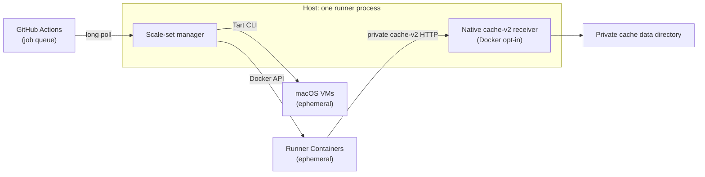

# runner

[](https://github.com/ysya/runscaler/releases)
[](https://go.dev)
[](LICENSE)
[](https://goreportcard.com/report/github.com/ysya/runscaler)

[Website](https://runscaler.ysya.dev/) · [Config builder](https://runscaler.ysya.dev/configure/) | [English](README.md) | [繁體中文](README.zh-TW.md)

Auto-scale GitHub Actions self-hosted runners as Docker containers or macOS VMs. Powered by [actions/scaleset](https://github.com/actions/scaleset).

Runners are **ephemeral** — each container/VM handles exactly one job and is removed upon completion. No Kubernetes required.

**Pre-1.0 stability:** Runscaler is under active development. Minor releases may
change or remove commands, configuration options, runner images, and cache
formats. Patch releases aim to preserve compatibility. Read the
[release notes](https://github.com/ysya/runscaler/releases) and
[upgrade requirements](#upgrade-requirements) before upgrading, and back up
configuration and data you need to keep.

## Table of Contents

- [How It Works](#how-it-works)
- [Features](#features)
- [Quick Start](#quick-start)
  - [Linux system service](#linux-system-service)
  - [macOS user service](#macos-user-service)
- [Commands](#commands)
- [Documentation](#documentation)
- [Upgrade requirements](#upgrade-requirements)
- [License](#license)

## How It Works



1. Registers a [runner scale set](https://docs.github.com/en/actions/hosting-your-own-runners/managing-self-hosted-runners-with-actions-runner-controller/about-actions-runner-controller) with GitHub
2. Long-polls for job assignments via the scaleset API
3. Spins up Docker containers or macOS VMs with JIT (just-in-time) runner configs
4. Removes containers/VMs automatically when jobs complete
5. Drains in-flight jobs on a graceful stop and reconciles resources left by an abnormal stop at the next startup

For opted-in Docker scale sets, the same `runner` process also starts the Go
cache-v2 receiver on a separate private HTTP listener. Cache-capable runner and
BuildKit containers reach it through `[actions-cache].advertise-url`; completed
entries and payloads live in `[actions-cache].data-dir`. No separate cache
daemon or container is required for the native mode. The receiver forwards
non-cache Results requests, including artifacts, to GitHub. An independently
managed receiver remains available through `docker.actions-cache-url`.
See [Host-local Actions cache](docs/local-actions-cache.md) for both modes.

## Features

- **Zero Kubernetes** — runs directly on any Docker host or Apple Silicon Mac
- **Ephemeral runners** — each job gets a fresh container/VM, no state leakage
- **Auto-scaling** — scales from 0 to N based on job demand via long-poll (no cron, no polling delay)
- **Docker-in-Docker** — optional DinD support for workflows that build containers
- **macOS VMs via Tart** — native Apple Virtualization.framework with APFS Copy-on-Write cloning
- **Tart networking** — shared NAT by default, with optional host-interface bridging
- **VM warm pool** — pre-boot macOS VMs for instant job pickup (~2s vs ~30s cold boot)
- **Native Actions cache (Docker opt-in)** — built-in cache-v2 receiver with host-local retention and status visibility
- **Shared work volume** — optional named Docker volume for explicit cross-job file handoff; legacy cache-volume mounts remain during sunset
- **Multi-org support** — manage multiple scale sets from a single process, mixing Docker and Tart providers
- **Self-healing capacity** — replace containers/VMs that exit before GitHub reports job completion
- **Safe restarts** — SIGTERM/SIGQUIT stop new work and wait for in-flight jobs; startup reclaims containers/VMs left by hard kills
- **Operational safety** — one process per host, localhost-only health checks, and built-in rotating logs
- **Single binary** — no runtime dependencies beyond Docker (or Tart for macOS)
- **Config file or flags** — TOML config with CLI flag overrides

## Quick Start

Use the [config builder](https://runscaler.ysya.dev/configure/) to choose
your host and copy a TOML config. Save it at the path below and add your GitHub
[App or PAT](docs/configuration.md#github-credentials-and-pat-permissions) on
the host; the website never asks for credential contents. The Linux system
installer checks the config, Docker access, and GitHub credentials before starting.

### Linux system service

Docker scale sets require Docker API 1.49 or newer (Docker Engine 28.1+).

Start Docker on the host, then run:

```bash
curl -fsSL https://raw.githubusercontent.com/ysya/runscaler/main/install.sh | sudo sh
sudo install -d -m 0700 /etc/runner
sudoedit /etc/runner/config.toml  # Paste the TOML and fill the credential locally
sudo chmod 0600 /etc/runner/config.toml
sudo /usr/local/bin/runner service install --config-path /etc/runner/config.toml
sudo /usr/local/bin/runner status
```

The service uses a dedicated non-root account. In the builder, choose Docker
and enter the scale-set name you will use in `runs-on`. See
[Deployment](docs/deployment.md#service-layout) for user services, credential
environment files, and other installation methods.
After a successful install, runner prints a copyable `runs-on` line for each
configured scale set.

### macOS user service

Install [Tart](https://tart.run/) and pull a macOS image compatible with your
host; [Tart setup and image choices](docs/deployment.md#tart-prerequisites-macos)
has the commands. Then run from a local GUI login session:

```bash
curl -fsSL https://raw.githubusercontent.com/ysya/runscaler/main/install.sh | sh -s -- --user
mkdir -p ~/.config/runner
chmod 0700 ~/.config/runner
nano ~/.config/runner/config.toml  # Paste the TOML and fill the credential locally
chmod 0600 ~/.config/runner/config.toml
~/.local/bin/runner validate
~/.local/bin/runner service install --scope user
~/.local/bin/runner status
```

In the builder, choose Tart, enter the image you pulled, and use the scale-set
name you will put in `runs-on`. The LaunchAgent starts when you log in. A
Linux user service uses the same runner commands after a user installation;
see [Deployment](docs/deployment.md#service-layout).

In your workflow, use the name entered in the builder (also printed after
service installation):

```yaml
jobs:
  build:
    runs-on: my-runners
    steps:
      - uses: actions/checkout@v4
      - run: echo "Running on auto-scaled runner!"
```

For a foreground run or CLI flags, see [Commands](docs/commands.md) and
[Configuration](docs/configuration.md).

## Commands

| Command                  | Description                                            |
| ------------------------ | ------------------------------------------------------ |
| `runner run`             | Start the runner manager                               |
| `runner validate`        | Validate configuration and connectivity                |
| `runner status`          | Show capacity, jobs, native cache, and disk headroom |
| `runner doctor`          | Diagnose GitHub connectivity and orphaned containers/VMs |
| `runner cache`           | Show disk usage and retention policy for every cache store |
| `runner logs`            | Show/follow runner's rotating log file                  |
| `runner service`         | Install, regenerate (`--force`), start, stop, and inspect the service |
| `runner version`         | Show version, commit, build date, and runtime info     |
| `runner update`          | Update runner to the latest release                    |
| `runner update --check`  | Check for updates without installing                   |
| `runner update --restart` | Update, validate the config and restart the service   |
| `runner scaleset delete` | Remove a retired scale set from GitHub                 |

Details for each command are in [docs/commands.md](docs/commands.md).

## Documentation

| Guide | Covers |
| --- | --- |
| [Commands](docs/commands.md) | Status dashboard, updating, troubleshooting with `doctor`, logs, runner startup and failure recovery |
| [Configuration](docs/configuration.md) | Config file (TOML), GitHub App authentication, token security, CLI flags |
| [Host-local Actions cache](docs/local-actions-cache.md) | Built-in receiver architecture, external receiver option, rollout and recovery |
| [Caching](docs/caching.md) | What can be reclaimed, the disk guard, store retention settings, visibility |
| [Security & Isolation](docs/security.md) | Docker socket sharing, per-scale-set isolation settings, Tart VM isolation |
| [Deployment](docs/deployment.md) | Graceful shutdown, service layout, systemd |
| [Development](docs/development.md) | Building from source, architecture |

## Upgrade requirements

`runner init` is removed. Existing config files and installed services keep
working; create new config files with the [config builder](https://runscaler.ysya.dev/configure/)
and add credentials on the host.

**Actions cache setting sunset (no removal in this release):** Docker scale sets
using the built-in Go receiver should set `native-actions-cache = true` and
remove `actions-cache-url` when it equals `[actions-cache].advertise-url`.
The manager derives that URL automatically. The old native URL setting still
works for now, but `runner validate`, startup logs and `runner update --check`
warn about it before a future breaking removal. Explicit URLs for external
receivers remain supported. Keep `advertise-url`: it is the address that runner
and BuildKit containers must be able to reach. Migrate while jobs are drained,
validate the config, then restart the selected service. This setting change does
not move or delete cached data. Older binaries cannot report a sunset introduced
after they were built; read the target release notes before updating.
Legacy `docker.cache-volumes` and `[[docker.cache]]` mounts are also in their
sunset period. They remain active with their existing budgets; migrate workflows
to Actions cache and verify warm hits before removing those mounts or data.
Track the earliest removal reviews and their acceptance gates in
[issue #41](https://github.com/ysya/runscaler/issues/41): v0.22.0 for the native
URL alias, v0.24.0 for legacy cache volumes. Neither version removes a setting
automatically; defer the change if the migration gates are unmet.

The historical rename transition is retired. Releases contain only `runner-*`
archives. The `migrate` command, implicit root `runner --config` startup,
`--backend`, automatic `runscaler` config-directory search, old service names
and `RUNSCALER_TOKEN` fallback are no longer supported. Start the manager with
`runner run --config /absolute/path/config.toml`.

Use the current setting names before upgrading:

| Removed setting | Current setting |
| --- | --- |
| `backend` | `provider` |
| `docker.shared-volume-ttl` | `docker.shared-volume-max-age` |
| `tart.cache-space-budget` | `tart.cache-budget` |
| `RUNSCALER_TOKEN` fallback | `RUNNER_TOKEN` |

Removed TOML keys cause an explicit error; they are never silently translated
or ignored. Rename-era installations need manual preparation of their binary,
config and service definition before upgrading to this version. Existing data
and old backup files are left untouched. Current `runner` system services that
run as root remain supported and keep that identity through update/--force.

For standalone commands, config discovery checks the working directory, the
current user's runner config directory, then `/etc/runner`. Explicit `--config`
selects its exact path. Absolute `XDG_CONFIG_HOME` and `XDG_STATE_HOME` customize
user config/state; relative values are ignored. User service installation
records those values and its absolute config path, while management commands
select the installed service's config. The builder describes the standard
config paths; `service install --config-path` takes precedence over
`--config`.

## License

MIT
