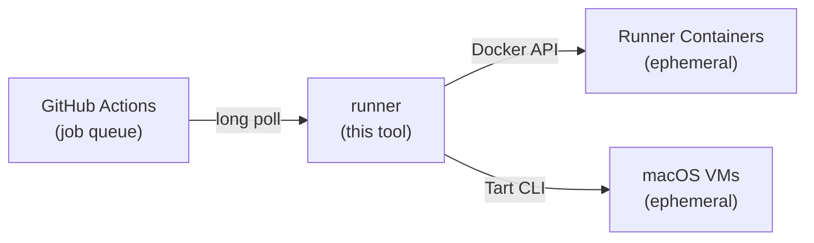

# runner

[](https://github.com/ysya/runscaler/releases)
[](https://go.dev)
[](LICENSE)
[](https://goreportcard.com/report/github.com/ysya/runscaler)

[English](README.md) | [繁體中文](README.zh-TW.md)

Auto-scale GitHub Actions self-hosted runners as Docker containers or macOS VMs. Powered by [actions/scaleset](https://github.com/actions/scaleset).

Runners are **ephemeral** — each container/VM handles exactly one job and is removed upon completion. No Kubernetes required.

## Table of Contents

- [How It Works](#how-it-works)
- [Features](#features)
- [Quick Start](#quick-start)
  - [Prerequisites](#prerequisites)
  - [Install](#install)
  - [Run](#run)
- [Commands](#commands)
  - [Updating](#updating)
- [Configuration](#configuration)
  - [Config File (TOML)](#config-file-toml)
  - [GitHub App Authentication](#github-app-authentication)
  - [Token Security](#token-security)
  - [CLI Flags](#cli-flags)
- [Caching](#caching)
  - [What Can Be Reclaimed](#what-can-be-reclaimed)
  - [The Disk Guard](#the-disk-guard)
  - [Store Retention Settings](#store-retention-settings)
  - [Visibility](#visibility)
- [Security & Isolation](#security--isolation)
- [Deployment](#deployment)
  - [Graceful Shutdown](#graceful-shutdown)
- [Building](#building)
- [Architecture](#architecture)
- [Upgrade requirements](#upgrade-requirements)
- [License](#license)

## How It Works



1. Registers a [runner scale set](https://docs.github.com/en/actions/hosting-your-own-runners/managing-self-hosted-runners-with-actions-runner-controller/about-actions-runner-controller) with GitHub
2. Long-polls for job assignments via the scaleset API
3. Spins up Docker containers or macOS VMs with JIT (just-in-time) runner configs
4. Removes containers/VMs automatically when jobs complete
5. Drains in-flight jobs on a graceful stop and reconciles resources left by an abnormal stop at the next startup

## Features

- **Zero Kubernetes** — runs directly on any Docker host or Apple Silicon Mac
- **Ephemeral runners** — each job gets a fresh container/VM, no state leakage
- **Auto-scaling** — scales from 0 to N based on job demand via long-poll (no cron, no polling delay)
- **Docker-in-Docker** — optional DinD support for workflows that build containers
- **macOS VMs via Tart** — native Apple Virtualization.framework with APFS Copy-on-Write cloning
- **Tart networking** — shared NAT by default, with optional host-interface bridging
- **VM warm pool** — pre-boot macOS VMs for instant job pickup (~2s vs ~30s cold boot)
- **Shared volumes** — cross-runner caching via named Docker volumes
- **Multi-org support** — manage multiple scale sets from a single process, mixing Docker and Tart providers
- **Self-healing capacity** — replace containers/VMs that exit before GitHub reports job completion
- **Safe restarts** — SIGTERM/SIGQUIT stop new work and wait for in-flight jobs; startup reclaims containers/VMs left by hard kills
- **Operational safety** — one process per host, localhost-only health checks, and built-in rotating logs
- **Single binary** — no runtime dependencies beyond Docker (or Tart for macOS)
- **Config file or flags** — TOML config with CLI flag overrides

## Quick Start

### Prerequisites

- **Docker provider:** Docker running on the host
- **Tart provider (macOS):** Apple Silicon Mac with [Tart](https://tart.run/) installed:

  ```bash
  # Homebrew 7 refuses formulae from a tap you have not trusted
  brew trust --formula openai/tools/tart openai/tools/softnet
  brew install openai/tools/tart

  # Pull a macOS runner image (pre-installed with Xcode and runner dependencies)
  tart pull ghcr.io/cirruslabs/macos-golden-gate-xcode:latest
  ```

  > **Upgrading from the `cirruslabs/cli` tap:** Tart moved to `openai/tools`, so `brew upgrade` never gets past the last `cirruslabs/cli` release (2.32.x). Run `brew uninstall tart softnet`, then the two commands above, then remove the old tap. Homebrew will not untap formulae it does not trust, so trust them just for that: `brew trust --formula cirruslabs/cli/tart cirruslabs/cli/softnet && brew untap cirruslabs/cli && brew untrust --formula cirruslabs/cli/tart cirruslabs/cli/softnet`. Avoid `brew untap --force`, which uninstalls every formula it attributes to the tap.

  > **Note:** Apple's Virtualization.framework limits each host to **2 concurrent macOS VMs**. Set `max-runners` accordingly. Each VM slot reuses a deterministic MAC address to reduce DHCP lease churn — no sudo required for MAC assignment.

  The default VM resources from Cirrus Labs images:

  | Image | CPU | Memory | Disk |
  | ----- | --- | ------ | ---- |
  | `ghcr.io/cirruslabs/macos-golden-gate-xcode:latest` (macOS 27) | 4 cores | 8 GB (8192 MB) | 140 GB |
  | `ghcr.io/cirruslabs/macos-tahoe-xcode:latest` (macOS 26) | 4 cores | 8 GB (8192 MB) | 140 GB |
  | `ghcr.io/cirruslabs/macos-sequoia-xcode:latest` (macOS 15) | 4 cores | 8 GB (8192 MB) | 140 GB |

  Image tags track the Xcode version, not macOS (e.g. `macos-golden-gate-xcode:27.2` ships Xcode 27.2); pin a tag instead of `latest` for reproducible builds. A guest cannot run a newer macOS than its host, so a macOS 26 host needs `macos-tahoe-xcode`.

  Override per VM with `cpu` and `memory` under `[tart]` in config. For iOS builds (Xcode), 8 GB+ is recommended.

- GitHub credentials: a [GitHub App](#github-app-authentication) or a **Personal Access Token**. PAT scopes depend on token type and runner level:

  | Token type           | Organization runners                                               | Repository runners                 |
  | -------------------- | ------------------------------------------------------------------ | ---------------------------------- |
  | **Classic PAT**      | `admin:org`                                                        | `repo`                             |
  | **Fine-grained PAT** | Self-hosted runners: **Read and write** + Administration: **Read** | Administration: **Read and write** |

  > **Note:** The token owner must be an **org owner** (for org runners) or have **admin access** to the repo (for repo runners). Fine-grained PATs targeting an organization may also require [admin approval](https://docs.github.com/en/organizations/managing-programmatic-access-to-your-organization/setting-a-personal-access-token-policy-for-your-organization) depending on org policy.

### Install

**Shell script (Linux/macOS):**

```bash
# Linux: root-owned system binary (the service runs as non-root)
curl -fsSL https://raw.githubusercontent.com/ysya/runscaler/main/install.sh | sudo sh

# macOS: user binary; Linux: opt into a user installation
curl -fsSL https://raw.githubusercontent.com/ysya/runscaler/main/install.sh | sh -s -- --user
```

Linux defaults to system installation at `/usr/local/bin` and requires root. macOS defaults to `~/.local/bin`; Linux `--user` uses the same user-owned location. The script downloads a binary only; it does not create an account or service. System binaries may use another absolute location if the file and every ancestor are protected from non-root writes. Set `INSTALL_DIR` to customize, or `RUNNER_VERSION` to pin a version:

```bash
# Install the system binary elsewhere (the directory and every ancestor must be root-only)
curl -fsSL https://raw.githubusercontent.com/ysya/runscaler/main/install.sh | sudo env INSTALL_DIR=/opt/runner/bin sh

# Pin a specific version
curl -fsSL https://raw.githubusercontent.com/ysya/runscaler/main/install.sh | RUNNER_VERSION=v1.2.3 sh -s -- --user
```

**Go install:**

```bash
go install github.com/ysya/runscaler/cmd/runner@latest
```

**Binary releases:**

Download from [Releases](https://github.com/ysya/runscaler/releases) and add to your `PATH`.

### Run

```bash
# Generate config interactively
# (writes ~/.config/runner/config.toml, or /etc/runner/config.toml as root)
runner init

# Validate everything before starting (the standard config path is found automatically)
runner validate

# Start scaling
runner run

# Or using CLI flags directly
runner run \
  --url https://github.com/your-org \
  --name my-runners \
  --token ghp_xxx \
  --max-runners 10

# Dry run — validate config, Docker, and images without starting listeners
runner run --dry-run
```

Then in your workflow:

```yaml
jobs:
  build:
    runs-on: my-runners  # matches --labels (defaults to --name if not set)
    steps:
      - uses: actions/checkout@v4
      - run: echo "Running on auto-scaled runner!"
```

## Commands

| Command                  | Description                                            |
| ------------------------ | ------------------------------------------------------ |
| `runner run`             | Start the runner manager                               |
| `runner init`            | Generate a config file interactively                   |
| `runner validate`        | Validate configuration and connectivity                |
| `runner status`          | Show capacity, connections, jobs, queues, and disk headroom |
| `runner doctor`          | Diagnose GitHub connectivity and orphaned containers/VMs |
| `runner cache`           | Show disk usage and retention policy for every cache store |
| `runner logs`            | Show/follow runner's rotating log file                  |
| `runner service`         | Install, regenerate (`--force`), start, stop, and inspect the service |
| `runner version`         | Show version, commit, build date, and runtime info     |
| `runner update`          | Update runner to the latest release                    |
| `runner update --check`  | Check for updates without installing                   |
| `runner scaleset delete` | Remove a retired scale set from GitHub                 |

### Status dashboard

`runner status` turns the local `/healthz` snapshot into an operator-friendly
dashboard. The summary rolls up ready scale sets, runner lifecycle
(`provisioning`, `idle`, `busy`, `removing`), desired runners, queue depth, and
process-lifetime job counters. It also shows host-wide `concurrent` capacity as
`in_use / limit`. Each scale set then shows its connection state, last
successful connection, and last error. The disk section shows cheap
filesystem-level free-space readings; use `runner cache` when you need the
slower per-store usage measurements.

```bash
# Human-readable dashboard; color is enabled automatically in a terminal
runner status

# Stable machine-readable health response
runner status --json

# Plain dashboard for logs or terminals where color is undesirable
runner status --no-color
```

Each scale set's optional `runtime` object in `/healthz` (and `status --json`)
reports startup attempts, failures, consecutive failures, the last attempt and
successful start, global-capacity waiting, and draining. Counters last for the
manager process's lifetime. Missing startup timestamps mean no such event has
been recorded. Failure reasons are safe categories (`jit_config_failed` or
`provider_start_failed`), not raw provider errors or credential values.

`/healthz` remains a liveness endpoint returning HTTP 200. Its JSON `status`
becomes `degraded`, and `/readyz` returns HTTP 503, when a listener is disconnected,
a controller is draining, or a failed startup still leaves demand unmet. An
unfinished retry does not restore readiness; a successful start does. Normal
waits for global host capacity, scale-to-zero, and historical failures after
demand disappears are not faults. Runtime snapshots perform no provider or
GitHub requests. The dashboard explains these states as `ERROR`,
`WAITING FOR CAPACITY`, or `DRAINING`, with startup counts and timestamps.

### Updating

Read the [upgrade requirements](#upgrade-requirements) and the target release's
notes before replacing a working installation. Older commands, settings and
credential environment variables may require manual preparation.

```bash
# Check for a release and review its upgrade requirements without installing
runner update --check

# After preparing the installation, update its selected binary
runner update
```

`runner update` displays the selected service scope, runtime user, binary and
config, downloads the archive for your platform, verifies its SHA-256 checksum
against `checksums.txt`, then atomically replaces the binary. It does not
validate configuration/provider compatibility, rewrite service definitions or
restart services. Existing system/user scope and runtime identity are retained;
an existing root service is not converted to a non-root account.

After installation, the command prints an explicit validation command for the
selected config. Run it with the service's credentials, provider access and
groups. The restart hint uses the selected binary and `--scope user|system`;
system service management needs an administrative shell. A matching health
version is not proof of configuration compatibility or readiness. If health is
disabled or unavailable, the running version is reported as unverified rather
than assumed stopped. With `--binary-path` or no installed service, no service
is selected: restart processes using that binary manually after validation.

SIGTERM normally begins a drain and waits for active jobs, bounded by
`drain-timeout` and the service manager's stop timeout. Jobs may be terminated
when drain is disabled or either deadline expires; check these settings before
restarting.

The messages above come from the updater already installed. An older updater
cannot show newly added warnings during its first upgrade. For that transition,
keep the previous binary and config backed up, download/extract the new binary
to a separate path, and validate the existing config with that new binary in
the intended runtime environment before replacing the service binary:

```bash
/path/to/new/runner validate --config /absolute/path/config.toml
```

The scale set itself stays registered across restarts, so a job queued while
runner is stopped — for an upgrade, a reboot, or after a crash — is picked up
as soon as runner reconnects. runner never deletes a scale set on its own: when
you retire a `[[scaleset]]`, stop runner and remove it from GitHub with
`runner scaleset delete <name>`.

### Troubleshooting with `doctor`

If runner is killed unexpectedly (e.g. `kill -9`, crash, power loss), Docker
containers or Tart VMs may be left behind. The next `runner run` reconciles
them automatically after acquiring the machine-wide lock. Use `doctor` for a
manual check while runner is stopped:

```bash
# Check GitHub API connectivity and orphaned resources
runner doctor

# Auto-remove orphaned containers and VMs
runner doctor --fix
```

Doctor probes every configured scale set's GitHub API using its App or PAT
credentials, resolves its runner group, and queries its registration. Each
probe has a five-second timeout; failures do not prevent later probes or local
resource checks. Cancellation stops further probes. A scale set that is not
registered yet is reported without creating or modifying it.

Failed API checks make the command exit unsuccessfully even when there are no
orphaned resources. Reports contain safe cancellation, timeout, DNS, TLS, or
numeric HTTP-status categories; raw SDK response bodies are not printed.

The `--fix` flag takes the same machine-wide lock as `runner run`, so it refuses
to remove resources while any current runner instance is active. Shared and
cache volumes are never removed by startup reconciliation or `doctor --fix`:
they intentionally outlive the process and may still contain data needed by a
later job in an in-flight workflow.

Startup reconciliation and `doctor` recognise runner's resources by the same
rules: a container carries the `managed-by=runner` label or an exact
`runner-<8 hex>` name, and a local Tart VM carries an exact `runner-`, `pool-`
or `runner-keep-` name of the form runner generates. Nothing else is ever
removed, however it is named.

### Logs

`runner run` writes to stdout and a rotating file (10 MB plus one backup). The
file's default location depends on who runs it:

| Runs as | Log file |
| --- | --- |
| Linux system service (dedicated account or root), or `sudo runner run` | `/var/log/runner/runner.log` |
| a user on Linux | `$XDG_STATE_HOME/runner/runner.log` (`~/.local/state/runner/runner.log`) |
| a user on macOS | `~/Library/Logs/runner/runner.log` |

Set `log-file` to an explicit path, or `log-file = ""` to disable file logging.
As root, `log-file` must be in a directory under `/var/log` whose name uses only
letters, digits, `.`, `_` or `-`; anything else falls back to the default with a
warning. Releases before v0.10 wrote `runner.log` beside the config; that file is
left in place.

Log output on stdout is colored only when stdout is a terminal; under systemd,
launchd, `docker run` without `-t`, CI or a pipe it stays plain. The log file
never contains color codes. Set `NO_COLOR=1` to turn color off or
`CLICOLOR_FORCE=1` to force it on.

```bash
runner logs                 # last 100 lines (add sudo for a system service)
runner logs -n 500 -f
```

Only one `runner run` process may be active on a host. Put every organization
or repository in that process using multiple `[[scaleset]]` entries.

### Runner startup and failure recovery

Docker runners remain provisioning until their logs report `Listening for Jobs`
and the container stays alive for five more seconds. GitHub work assignment or
completion also proves startup. The default deadline is five minutes. Images
with a custom entrypoint that cannot emit this marker can set
`docker.readiness = false`; status then reports `unverified` and a warning is
logged. `docker.ready-timeout` changes the deadline. A non-root Docker client
does not imply that its Docker daemon is rootless.

Failed starts retry with jitter: 2.5–5 seconds initially, doubling up to
`retry.max` (default one minute). After five consecutive failures, retries enter
a five-minute cooldown. Configure `[retry]` with `initial`, `max`,
`cooldown-after`, and `cooldown`, globally or per scale set. Fresh demand cannot
bypass the deadline, and minimum runners still apply with an empty queue.
Verified recovery resets the relevant failure generation. Tart warm-pool slots
use independent retry histories; job execution exits and cleanup retries do not
increase startup failures. `runner status` and health JSON expose readiness,
retry state/deadline, and safe failure metadata.

Failure diagnostics are enabled by default under `diagnostics/` beside the log
file actually opened, including its fallback. With file logging disabled, the
scope's default log directory is used. Reports use a private directory (0700)
and files (0600), retain at most 20 files / 2 MiB / seven days, and include known
exit code, OOM and finish time without inventing unknown values. Failed cleanup
retains capacity until removal succeeds. Unknown GitHub identity is preserved
until work evidence permits cleanup or explicit force shutdown.

Raw logs are off by default. `diagnostics.capture-logs = true` opts into bounded
excerpts (100 lines / 64 KiB), with configured PAT/JIT values, Authorization
headers and PEM blocks redacted. This cannot identify every workflow secret;
keep capture off when jobs may print sensitive data. Set
`diagnostics.enabled = false` to disable reports. Diagnostics never include raw
logs in health JSON and a collection/write failure does not prevent cleanup.

## Configuration

Configuration can be provided via a TOML config file (`--config`) or CLI flags. When both are provided, CLI flags take priority over config file values.

Unknown config keys (typos, options from another version) are not silently
ignored: `runner run` logs a warning for each and keeps starting, while
`runner validate` fails on them. The same applies to single-mode keys
(`url`, `name`, `token`, `github-app`, `labels`, `min-runners`) left at the top level
when `[[scaleset]]` entries exist.

### Config File (TOML)

**Docker provider (default):**

```toml
# config.toml
url = "https://github.com/your-org"
name = "my-runners"
token = "ghp_xxx"
max-runners = 10
min-runners = 0
labels = ["self-hosted", "linux"]
runner-image = "ghcr.io/actions/actions-runner:latest"
runner-group = "default"
log-level = "info"
log-format = "text"
concurrent = 10                          # host-wide across all scale sets; 0 = automatic sum
# log-file = "/var/log/runner/runner.log" # default: /var/log/runner/runner.log (root), ~/.local/state/runner/runner.log (Linux), ~/Library/Logs/runner/runner.log (macOS); "" disables
health-address = "127.0.0.1"              # localhost-only by default
health-port = 8080
# drain-timeout = "2h"                    # 0s disables graceful drain

[docker]
socket = "/var/run/docker.sock"
dind = true
shared-volume = "/shared"
# shared-volume-max-age = "168h"        # delete shared-volume files older than this; unset = never reclaimed
# buildx-cleanup = true                 # opt in only on a runner-dedicated daemon
# buildx-cleanup-ttl = "24h"            # remove buildx builders older than this
# buildx-cleanup-interval = "6h"        # how often the buildx sweep runs
# prune = true                          # opt in only on a runner-dedicated daemon
# prune-interval = "6h"                 # how often the runtime prune sweep runs
# prune-ttl = "24h"                     # remove stopped containers and dangling images older than this
# build-cache-max-age = "168h"          # prune build cache entries not used within this window
# build-cache-budget = 0                # cap daemon build cache to N GB (0 = no cap)
```

When runners build images with `docker buildx` (e.g. via
`docker/setup-buildx-action`), each run can leave behind a BuildKit builder
container plus a multi-GB `buildx_buildkit_*_state` volume. On a persistent host
sharing one Docker daemon these accumulate until the disk fills. On a daemon
dedicated to runners, opt in with `buildx-cleanup = true`; runner then removes
builders older than `buildx-cleanup-ttl`. Do not enable it when persistent
builders or unrelated workloads share the daemon.

Beyond buildx builders, jobs mounting the host Docker socket leave dangling
images, stopped containers, and daemon build cache behind on every build. The
runtime prune sweep (opt in with `prune = true`) reclaims these on a timer while
runner is up: stopped containers and dangling images older than `prune-ttl`,
build cache not used within `build-cache-max-age`, and — with
`build-cache-budget` set — build cache above the GB cap. It assumes the daemon
is dedicated to runners: matching objects are treated as job garbage
regardless of what created them. Keep it disabled on a shared daemon.

`prune`/`buildx-cleanup` being off only turns off *this* daemon's routine
sweep — the host-wide disk guard (see [Caching](#caching)) still reclaims
through both once a filesystem is actually under pressure, regardless of
these switches.

**Tart provider (macOS):**

```toml
# config.toml
provider = "tart"
url = "https://github.com/your-org"
name = "macos-runners"
token = "ghp_xxx"
max-runners = 2          # Apple limits 2 concurrent macOS VMs per host
runner-image = "ghcr.io/cirruslabs/macos-golden-gate-xcode:latest"
labels = ["self-hosted", "macOS"]
log-level = "info"

[tart]
cpu = 4                  # CPU cores per VM (0 = use image default)
memory = 8192            # Memory in MB per VM (0 = use image default)
runner-dir = "/Users/admin/actions-runner"  # default
pool-size = 2            # pre-warm 2 VMs for instant job pickup (~2s vs ~30s cold boot)
# home = "/Volumes/Data/tart"          # TART_HOME for the tart CLI ("" = ~/.tart)
# cache-budget = 80                    # cap OCI/IPSW cache to N GB via `tart prune` (0 = disabled)
# cache-cleanup-interval = "24h"       # how often the prune sweep runs
# mtu = 0                              # guest MTU: 0 = match a VPN tunnel (default), -1 = off, 1280–1500 = fixed
# dns = ["1.1.1.1", "8.8.8.8"]         # guest resolvers ([] = keep the one Tart's NAT hands out)
# net-bridged = "en0"                  # bridge VMs to this host interface instead of Tart's NAT
```

With `home` set, point your own tart commands at the same directory —
`TART_HOME=/Volumes/Data/tart tart list`. A bare `tart list` reads `~/.tart`
and shows none of runner's images or VMs.

Xcode VM images are huge (50–80 GB each) and `:latest` tags accumulate old
layers under `$TART_HOME/cache/` — set `cache-budget` to keep it bounded.
The sweeper only touches OCI/IPSW caches, never your local VMs. Before every
prune it marks each Tart scale set's `runner-image` as just used, so a week
without jobs no longer evicts the image the next job clones from, and under
`cache-budget` that image is evicted last.

**Hosts behind a VPN (Cloudflare WARP, Tailscale exit nodes, corporate
VPNs).** A tunnel that cannot carry 1500-byte packets breaks the VMs while the
host itself keeps working: the guest advertises a full-size TCP MSS, servers
answer with 1500-byte packets the tunnel drops, and every TLS handshake from
the VM stalls — the runner starts but never connects, so jobs stay queued. By
default (`mtu = 0`) runner looks up the host's route to the scale set's GitHub
host before each runner starts and, when that route's MTU is below 1500, sets
the guest's MTU to match (`sudo -n ifconfig`, which the Cirrus Labs images
allow). Set a fixed `mtu` if the tunnel only carries some destinations, or
`-1` to leave guests alone. Tart's NAT also proxies DNS through the host, and
that proxy can stop answering after the host's VPN disconnects; set `dns` to
give the guests resolvers of their own.

**Choosing Tart networking (v0.12.0+).** Shared NAT remains the default. If
your VMs already obtain an address and connect to GitHub, keep `net-bridged`
unset or empty; upgrading does not require a networking change. NAT keeps
the VMs on the host's private network rather than giving each VM an address
on your LAN.

**Hosts whose NAT does not serve guests.** Tart's shared NAT depends on the
host's `bootpd` to hand each guest a lease. When it does not, the guest comes
up on a link-local `169.254.x.x` address with no route out, the runner never
reaches GitHub, and jobs stay queued. Set `net-bridged` to a host interface
(`net-bridged = "en0"`, the BSD device name `ifconfig` shows for the active
Ethernet or Wi-Fi) and every VM boots with `tart run --net-bridged=<interface>`, taking
its address from the LAN's DHCP server instead. Bridging connects each VM
directly to that LAN; it does not create a private runner network. The image
must leave the guest's network service on DHCP. The CLI equivalent is
`runner run --config config.toml --tart-net-bridged en0`. In multi-scale-set
configs, `[tart] net-bridged` is inherited; set `[scaleset.tart] net-bridged = ""`
to return an individual scale set to NAT.

Bridged guests do not leave through the host's
routing table, so `mtu = 0` no longer matches a host tunnel for them; a fixed
`mtu` and `dns` still apply. Bridged VM MAC addresses are derived from the host
interface's hardware address and the shared host slot, rather than reusing
the same fixed slot addresses on every host. The address stays stable for
the same interface hardware address and slot, allowing DHCP lease reuse;
changing the host interface's hardware address changes the VM addresses.
Startup fails and the clone is cleaned up if its bridged MAC cannot be read or
written safely. The DHCP server still controls IP allocation: this MAC policy
does not guarantee a fixed IP or resolve duplicated DHCP client identifiers
inside cloned images. Before relying on a bridged deployment, verify that
two concurrent VMs obtain distinct addresses and complete jobs after repeated
VM creation and removal; include multiple Mac hosts if they share the LAN.

**Docker networking.** These Tart settings do not apply to Docker runners.
They use Docker's default bridge unless `[docker] network` selects another
existing network. Docker manages address allocation; a dedicated Docker
bridge can already be selected with that setting (see
[Security & Isolation](#security--isolation)).

**Runner start-up check.** A runner that dies or never reaches GitHub leaves
its VM running, so runner hands a VM over only once the runner inside prints
`Listening for Jobs` and is still alive a few seconds later — the moment
GitHub refuses a retired runner version. If it exits first, or has not
connected within 5 minutes, runner deletes the VM, logs `Failed to start
runner` with the runner's own output (or the tail of its `_diag` log), and
retries.

**Custom VM images.** `runner-image` accepts a local VM name as well as an
OCI reference: startup checks `tart list` first and only pulls when the name
is absent. To bake project dependencies into the image (simulator runtimes,
CocoaPods/SPM caches, extra toolchains), clone a Cirrus Labs image, provision
it, stop it, and point `runner-image` at the result:

```bash
tart clone ghcr.io/cirruslabs/macos-golden-gate-xcode:latest ios-golden
tart run ios-golden --no-graphics &
tart exec -it ios-golden zsh      # runs as admin; install tools, warm caches
tart stop ios-golden
```

```toml
runner-image = "ios-golden"       # local VM — no registry needed
```

Every job still boots a fresh copy-on-write clone; runner never starts the
golden VM itself. Share it across hosts with `tart login ghcr.io` followed by
`tart push ios-golden ghcr.io/<org>/ios-golden:latest`, or make the build
reproducible with the
[Packer tart builder](https://github.com/openai/tart/blob/main/docs/integrations/packer.md)
and [macos-image-templates](https://github.com/cirruslabs/macos-image-templates).
Whatever the base, the image must keep the
[Tart Guest Agent](https://github.com/openai/tart/blob/main/docs/blog/posts/2025-06-01-tart-guest-agent.md)
running — runner drives VMs through `tart exec`, not SSH, and every
non-vanilla Cirrus Labs image already ships it — and must have the GitHub
Actions runner unpacked at `runner-dir` with an executable `run.sh`.
Provisioning the golden VM occupies one of the host's two macOS VM slots, so
do it while runner is not at capacity.

**Runner version retirement.** GitHub retires runner versions server-side:
each release gets a `runtime_deprecates_at` date some weeks after newer
releases ship, and a runner still on a retired version is refused on its first
poll for messages with
`Runner version vX.Y.Z is deprecated and cannot receive messages`, and exits.
The scale set still shows Online while every runner it starts dies, so jobs
stay queued; on Tart the start-up check above logs the refusal. Every
ephemeral container or VM starts at the runner version baked into its image,
and `disable-update` cannot change that: the update instruction arrives on the
same message poll GitHub refuses (see
[community discussion #206494](https://github.com/orgs/community/discussions/206494)),
so `disable-update = false` only makes a still-supported runner download the
latest release before its first job — it does not rescue a retired one. That
is why runner defaults to `disable-update = true` and the runner is refreshed
with the image instead: rebuild the container image, or replace
`actions-runner` in your golden VM. To see how long a version has left:

```bash
gh api repos/<owner>/<repo>/actions/runners/deprecations/<version>   # runtime_deprecates_at
```

The org-level endpoint (`orgs/<org>/actions/runners/deprecations/<version>`)
needs the `admin:org` scope.

### GitHub App Authentication

GitHub App authentication is supported for organization and repository runners.
Install the App on the organization or repository that owns the runners. For
organization runners, grant organization **Self-hosted runners: Read and write**.
For repository runners, grant repository **Administration: Read and write**;
repository **Metadata: Read-only** is included. Enterprise-level runners require
a PAT. See GitHub's [runner authentication guide](https://docs.github.com/en/actions/how-tos/manage-runners/use-actions-runner-controller/authenticate-to-the-api)
for App registration and permission details.

Configure the App's Client ID (preferred; a numeric App ID as a string also works),
Installation ID, and exactly one private-key source. These IDs are different;
the Installation ID identifies this App's installation on the target owner.
See [GitHub's JWT guide](https://docs.github.com/en/apps/creating-github-apps/authenticating-with-a-github-app/generating-a-json-web-token-jwt-for-a-github-app).

```toml
url = "https://github.com/your-org"
name = "app-runners"
max-runners = 2

github-app.client-id = "Iv1.example"
github-app.installation-id = 123456
github-app.private-key-file = "/absolute/path/to/runner-app.pem"
# Alternatively, replace private-key-file with an environment variable name:
# github-app.private-key-env = "RUNNER_GITHUB_APP_KEY"
```

The key must be an unencrypted RSA PEM key (PKCS#1 or PKCS#8), at most 64 KiB.
Use an absolute file path and keep the file outside the repository with private
permissions, such as `0600`. For an environment source, the named variable must
contain the complete PEM value with real newlines; the config stores only its
name. Keys are read when a client is created, so restart the manager after
rotating a key. The SDK signs JWTs and exchanges credentials as needed.

Generated service definitions do not copy App key environment variables from
the installing shell. Use a key file for these services, or supply the variable
through the service manager explicitly.

When App configuration is present, the `RUNNER_TOKEN` fallback is ignored.
An explicit `token` or `--token` together
with App configuration is an error. Incomplete App settings also fail instead
of silently selecting PAT authentication.

App credentials, like PAT credentials, are never inherited by `[[scaleset]]`
entries. Configure each installation independently; App and PAT scale sets can
run in the same process:

```toml
[[scaleset]]
url = "https://github.com/org-a"
name = "app-runners"
github-app.client-id = "Iv1.example"
github-app.installation-id = 123456
github-app.private-key-env = "ORG_A_APP_KEY"

[[scaleset]]
url = "https://github.com/org-b"
name = "pat-runners"
token = "env:ORG_B_TOKEN"
```

For non-interactive setup, `runner init` accepts the same App reference flags as
`runner run`, and writes the references without prompting for a PAT:

```bash
runner init --url https://github.com/your-org --name app-runners \
  --provider docker --max-runners 2 --dind=false --shared-volume="" \
  --github-app-client-id Iv1.example --github-app-installation-id 123456 \
  --github-app-private-key-file /absolute/path/to/runner-app.pem
```

`run`, `validate`, `doctor`, and `scaleset delete` use the same auth selection.
`doctor` performs read-only API probes for every configured scale set;
`validate` also checks provider connectivity and configuration.

### Token Security

Avoid passing tokens as CLI flags (visible in `ps` output). Two alternatives:

**Option 1: `RUNNER_TOKEN` environment variable** — automatically used when no `--token` flag or config value is set:

```bash
export RUNNER_TOKEN=ghp_xxx
runner run --url https://github.com/org --name my-runners
```

**Option 2: `env:` syntax in config file** — reference any environment variable by name:

```toml
token = "env:GITHUB_TOKEN"  # reads from $GITHUB_TOKEN at startup
```

Priority: `--token` flag > `RUNNER_TOKEN` env var > config file value (including `env:` resolution).

**Multiple scale sets (mixed Docker + Tart):**

```toml
# Global defaults (inherited by all scale sets)
runner-image = "ghcr.io/actions/actions-runner:latest"
runner-group = "default"
max-runners = 10
log-level = "info"

[docker]
socket = "/var/run/docker.sock"
dind = true

# Each [[scaleset]] runs independently.
# Inherits global settings if omitted.

[[scaleset]]
url = "https://github.com/your-org"
name = "linux-runners"
token = "ghp_aaa"

[[scaleset]]
provider = "tart"
url = "https://github.com/your-org"
name = "macos-runners"
token = "ghp_bbb"
max-runners = 2
runner-image = "ghcr.io/cirruslabs/macos-golden-gate-xcode:latest"
labels = ["self-hosted", "macOS"]
[scaleset.tart]
pool-size = 2
```

### CLI Flags

| Flag                | TOML key             | Default                                 | Description                                       |
| ------------------- | -------------------- | --------------------------------------- | ------------------------------------------------- |
| `--config`          |                      |                                         | Path to TOML config file                          |
| `--url`             | `url`                | (required)                              | Registration URL (org or repo)                    |
| `--name`            | `name`               | (required)                              | Scale set name (used as `runs-on` label)          |
| `--token`           | `token`              | (required for PAT mode)                 | GitHub Personal Access Token                      |
| `--github-app-client-id` | `github-app.client-id` | (unset)                              | GitHub App Client ID or numeric App ID as a string |
| `--github-app-installation-id` | `github-app.installation-id` | (unset)                  | GitHub App installation ID                        |
| `--github-app-private-key-file` | `github-app.private-key-file` | (unset)                | Absolute path to an RSA PEM key                   |
| `--github-app-private-key-env` | `github-app.private-key-env` | (unset)                  | Name of the environment variable containing the PEM key |
| `--provider`        | `provider`           | `docker`                                | Instance provider (`docker` or `tart`)             |
| `--max-runners`     | `max-runners`        | `10`                                    | Maximum concurrent runners                        |
| `--concurrent`      | `concurrent`         | `0` (sum of `max-runners`)              | Host-wide maximum across all scale sets           |
| `--min-runners`     | `min-runners`        | `0`                                     | Minimum runners to keep warm                      |
| `--labels`          | `labels`             | `<name>`                                | Runner labels (comma-separated)                   |
| `--runner-group`    | `runner-group`       | `default`                               | Runner group name                                 |
| `--runner-image`    | `runner-image`       | `ghcr.io/actions/actions-runner:latest` | Runner image (Docker image or Tart VM image)      |
| `--docker-socket`   | `[docker] socket`    | `/var/run/docker.sock`                  | Docker socket path (Docker provider)               |
| `--dind`            | `[docker] dind`      | `true`                                  | Mount Docker socket into runners (Docker provider) |
| `--shared-volume`   | `[docker] shared-volume` |                                     | Shared Docker volume path (Docker provider)        |
| `--tart-cpu`        | `[tart] cpu`         | `0` (image default)                     | CPU cores per VM (Tart provider)                   |
| `--tart-memory`     | `[tart] memory`      | `0` (image default)                     | Memory in MB per VM (Tart provider)                |
| `--tart-runner-dir` | `[tart] runner-dir`  | `/Users/admin/actions-runner`           | Runner install directory inside Tart VM           |
| `--tart-pool-size`  | `[tart] pool-size`   | `0`                                     | Number of pre-warmed VMs for instant job pickup   |
| `--tart-net-bridged` | `[tart] net-bridged` | `""` (Tart's NAT)                      | Host interface to bridge each VM to               |
| `--log-level`       | `log-level`          | `info`                                  | Log level (debug/info/warn/error)                 |
| `--log-format`      | `log-format`         | `text`                                  | Log format (text/json)                            |
| `--dry-run`         | `dry-run`            | `false`                                 | Validate everything without starting listeners    |
| `--health-address`  | `health-address`      | `127.0.0.1`                             | Health check listen address                       |
| `--health-port`     | `health-port`        | `8080`                                  | Health check HTTP port (0 to disable)             |

Process-wide `drain-timeout` and advanced tuning keys (cleanup, cache volumes,
isolation) are config-file only by design — see `config.example.toml` for the
full list.

Like GitLab Runner, `concurrent` is the manager-wide ceiling while each scale
set's `max-runners` is its local ceiling. The controller reserves global
capacity before JIT/provider startup, so multiple organizations and mixed
Docker/Tart scale sets cannot collectively oversubscribe the host. Capacity for
every scale set's `min-runners` floor is reserved before FIFO surplus capacity
is handed out. Leaving `concurrent` at `0` keeps backward-compatible behavior
by using the sum of all configured `max-runners` values.

Use the `provider` TOML key and `--provider` flag to select Docker or Tart.

## Caching

Ephemeral runners start cold — nothing survives between jobs unless you opt in. Three layers work together: a host-wide **disk guard** that reclaims space under real pressure, each store's own **retention settings** for routine cleanup, and `runner cache` for **visibility** into what is using space right now.

### What Can Be Reclaimed

Everything reclaimable on the host falls into one of three kinds, by what happens if it disappears — this is the classification the disk guard's tier ladder is built from:

| Kind | If it disappears | Examples |
| --- | --- | --- |
| **Garbage** | Nothing — already unreferenced | Dangling images, stopped containers, orphaned buildx builders, expired shared-volume files |
| **Cache** | The next build/job is a bit slower, nothing breaks | Docker layer/build cache, cache volumes, Tart's OCI/IPSW image cache |
| **Scratch** | An in-flight workflow run breaks | The shared volume's not-yet-expired contents |

This is what stops a build cache from landing where handoff data belongs: cache is free to reclaim whenever it's in the way; scratch never is, at any tier, regardless of disk pressure. The shared volume is the one store that is both, depending on age — mid-workflow it's scratch (a later job in the same run may still read what an earlier job wrote there), and once a file passes `shared-volume-max-age` it becomes garbage. Because of this, runner no longer deletes the shared volume at process exit: a restart (including a self-update) between two jobs of one workflow run no longer breaks the later job, and reclamation is left entirely to `shared-volume-max-age` and the guard's tier 3.

### The Disk Guard

`[disk]` runs a guard that watches every configured store, grouped by the filesystem it actually lives on, and reclaims space only under real pressure — it is not a sweeper running on a fixed timer regardless of need:

```toml
[disk]
guard       = true   # reclaim under disk pressure; false opts this host's disk out of guard management entirely
min-free    = "10%"  # free-space floor that triggers reclamation: a percentage of the filesystem, or a size like "20GB"
target-free = "20%"  # level reclamation aims to restore before stopping; must be greater than min-free
interval    = "1h"   # how often the periodic check runs
max-tier    = 3      # highest tier the guard may reclaim at (1-4)
```

**Per filesystem, not per host.** A Mac Studio with `TART_HOME` on a dedicated 931 GB volume and Docker on the system disk gets independent checks and independent thresholds for each — one host-wide "disk full" number would be meaningless there.

When a filesystem drops below `min-free`, the guard escalates through tiers in order, re-checking free space after each one, and stops as soon as `target-free` is met:

| Tier | Reclaims | Kind |
| --- | --- | --- |
| 1 | Dangling images, stopped containers, orphaned buildx builders | garbage |
| 2 | Build cache and image layers past their max-age | cache |
| 3 | shared-volume files past their max-age | scratch (expired portion only) |
| 4 | Cache volumes, wiped entirely | cache |

`max-tier` defaults to **3**: garbage and age-based trims happen automatically, but wiping a cache volume (tier 4) makes the next build cold, so it needs an explicit opt-in.

The guard also enforces any store's own configured budget (see below) on every sweep, independent of whether that store's filesystem is under pressure at all — and checks free space, a single cheap `statfs` rather than a full sweep, immediately before starting each runner, reclaiming synchronously first if that filesystem is already below `min-free`. This is what stops a job from filling the disk mid-build and taking down the whole host; a reclaim failure here is only logged, never fatal — refusing to start jobs is worse than a full disk.

### Store Retention Settings

Each store also keeps its own settings for routine, timer-driven cleanup — this is what already existed before the disk guard did, and still runs on its own schedule regardless of disk pressure.

**Docker layer/build cache (automatic).** With `dind = true` jobs talk to the host daemon directly, so `docker pull`/`docker build` layer caches are shared across all jobs and survive restarts. On a daemon dedicated to runners, the opt-in runtime prune sweep bounds growth — see [Config File (TOML)](#config-file-toml) above for `prune`, `prune-ttl`, `build-cache-max-age`, `build-cache-budget`.

> **BuildKit tip:** `docker/setup-buildx-action` creates a throwaway builder per job whose cache dies with the job (`buildx-cleanup` reclaims the leftovers). To actually reuse build cache across jobs, build with the daemon's built-in BuildKit (plain `docker build`, or buildx with `driver: docker`) so the cache lands where `build-cache-*` retention manages it instead.

**Cache volumes (`cache-volumes`, `[[docker.cache]]`).** Named volumes mounted into every runner container at tool-default cache paths, so workflows hit warm caches with zero workflow changes:

```toml
[docker]
cache-volumes = [
  "gradle-cache:/home/runner/.gradle",
  "pnpm-store:/home/runner/.local/share/pnpm/store",
]

# Long form, for an entry that needs a size budget. A name in both forms
# resolves entirely from its [[docker.cache]] entry, not merged field by field.
[[docker.cache]]
name      = "ccache"
path      = "/home/runner/.ccache"
budget    = "20GB"
on-exceed = "warn"   # warn (default): log only, leave eviction to the tool's own LRU | wipe: delete everything over budget
```

The short form is enough for most caches: created on first use, persistent, never swept by any TTL. Same volume name across scale sets shares the cache; different names isolate it. The long form adds an optional `budget`, enforced independently of disk pressure — the guard checks it on every sweep regardless of `max-tier` or whether the filesystem is actually under pressure. There is no partial eviction: `wipe` deletes the volume's entire contents once over budget. Fine-grained LRU is deliberately left to the tool itself (e.g. ccache's own `max_size`) — a content-addressed pnpm store or Gradle's `modules-2` metadata index would both break under a generic file-by-file sweep.

**Shared volume (`shared-volume`, `shared-volume-max-age`).** A general-purpose volume mounted at the same path in every runner (exposed as `$SHARED_DIR`) for workflows that pass files between jobs of one run explicitly:

```toml
[docker]
shared-volume                  = "/shared"
shared-volume-max-age          = "168h"  # delete files older than this
shared-volume-cleanup-interval = "6h"
```

Files are deleted only once older than `shared-volume-max-age` — never at process exit, and never while still within that window no matter how much disk pressure there is (the scratch classification above, enforced by the guard's tier 3 too). Set it longer than your longest workflow run.

`shared-volume-max-age` is the volume's *only* retention policy, so leaving it unset means nothing ever reclaims that volume: it isn't deleted at exit, and the guard won't touch un-expired scratch data at any tier. runner still measures it (it appears in `runner cache`) and warns at startup, but a shared volume with no max-age grows without bound.

**Tart OCI/IPSW cache (`cache-cleanup`, `cache-max-age`, `cache-budget`).** Xcode VM images are 50–80 GB each and `:latest` tags accumulate old layers under `$TART_HOME/cache/` — see [Config File (TOML)](#config-file-toml) above for the full `[tart]` example. The sweeper only touches OCI/IPSW caches, never your local VMs.

**Enable switches gate the routine sweep only.** `prune` (which covers both the dangling-image/stopped-container store and the build-cache store), `buildx-cleanup`, and `cache-cleanup` each turn that store's own *periodic, timer-driven* cleanup on or off — they do not exempt the store from the disk guard. `prune` and `buildx-cleanup` default off because a shared daemon may run workloads runner doesn't own, but the guard reclaims through their stores under real disk pressure regardless of the switch. It has to: `prune` and `buildx-cleanup` both default off, and `max-tier` defaults to 3 — a guard that also honored these switches would, on a Docker-only host, ship enabled by default yet unable to reclaim anything at all until an operator explicitly opted in to routine cleanup too. If a disk truly isn't runner's to manage — a daemon shared with unrelated workloads, say — the correct switch is `[disk] guard = false`, which opts that host's disk out of guard management entirely. Per-store switches were never designed to mean that.

### Visibility

`runner cache` measures every configured store and prints its size, the filesystem it lives on, that filesystem's current free percentage, and its retention policy:

```
$ runner cache
STORE               FILESYSTEM  SIZE     FS FREE  POLICY
docker-build-cache  /           12.4 GB  38%
ccache              /           18.1 GB  38%      budget=20.0 GiB on-exceed=warn
runner-shared       /           3.3 GB   38%
tart-cache          /Volumes/…  142 GB   58%
```

Add `--json` for scripting. Measuring can be expensive — some stores walk a volume via a short-lived helper container — so it is never on a hot path. For a cheap view that is safe to poll instead, `/healthz`'s `disk` section reports each filesystem's free percentage from a plain `statfs`, never a real measurement.

## Security & Isolation

**`dind = true` is Docker-socket sharing, not sandboxed Docker-in-Docker.** Runner containers mount the host's Docker socket, so any job can control the host daemon — start privileged containers, mount the host filesystem, inspect other jobs' containers. That is root-equivalent access to the host. Only run code you trust: **never expose these runners to pull requests from public forks**. Set `dind = false` for scale sets that don't need to build images. Daemon-wide buildx/prune sweepers are off by default and should only be enabled on a Docker daemon dedicated to runners.

Isolation knobs, all per scale set under `[docker]`:

| Key | Effect |
| --- | ------ |
| `memory`, `cpu` | cgroup limits per runner container |
| `pids-limit` | caps processes+threads per container (e.g. `4096`) so a fork bomb can't take down the host |
| `network` | attach runners to a pre-created Docker network instead of the default bridge, e.g. `docker network create --opt com.docker.network.bridge.enable_icc=false runners` |
| `shared-volume-name` | back each scale set's shared volume with a different named volume so scale sets of different trust levels don't share files |
| `dind = false` | no socket mount at all — strongest container-level isolation, no image builds |

The Tart provider isolates at the hypervisor boundary — each job gets a fresh macOS VM cloned from the base image and deleted afterwards.

## Deployment

### Graceful Shutdown

The default `drain-timeout` is `2h`. Shutdown signals have distinct meanings:

| Signal | Behavior |
| --- | --- |
| `SIGTERM` or `SIGQUIT` | Stop scaling up, remove idle runners, and wait for busy jobs to finish |
| Second signal during drain | Stop immediately and remove remaining runners |
| Third signal | Exit without waiting for cleanup |
| `SIGINT` / Ctrl-C | Stop immediately; never drain |

Before removing an apparently idle runner during drain or scale-down, runner
asks GitHub to deregister it. If GitHub has already assigned a job, the runner
is kept until that job finishes, even when `JobStarted` has not arrived yet.
Deregistration and cleanup failures are retried during drain until they succeed
or the configured drain timeout expires.

Interactive Ctrl-C intentionally keeps its conventional "stop now" meaning.
To drain a foreground process, send TERM explicitly:

```bash
kill -TERM <pid>
```

`runner service install` generates a systemd `TimeoutStopSec` or launchd
`ExitTimeOut` one minute longer than the configured drain budget and records
it, so runner warns when a later `drain-timeout` outgrows it. A binary update
does not rewrite an installed service definition; regenerate it in place:

```bash
sudo runner service install --scope system --force --config-path /etc/runner/config.toml   # Linux system service
runner service install --scope user --force --config-path ~/.config/runner/config.toml           # user service
```

`--force` validates the config and binary and renders the new definition before
touching the installed one. When a definition is outdated, runner logs the
command that fixes it, with the exact config and binary paths it is running
with: this `--force` reinstall, or for a root service whose binary is not root-owned, a
copy to `/usr/local/bin` followed by the reinstall.

After that, the normal upgrade flow is:

```bash
runner update              # add sudo when the binary is in /usr/local/bin
runner service restart     # waits for active jobs automatically
```

### Service layout

- **New Linux system services** are installed by root and run as the dedicated
  non-login `runscaler` account. The binary remains root-owned; config/App key
  files are `root:runscaler` with mode `0640`, and `/etc/runner` is `0750`.
  HOME and working directory are `/var/lib/runner`; state and logs are owned
  by the service account with mode `0750`. `ProtectSystem=strict` keeps config
  read-only; explicit writable paths cover `/tmp`, state and the configured
  log directory below `/var/log`. Installation refuses conflicting accounts,
  linked/shared credential files and populated directories owned by others.
  Ancestor directories, including the log parent, must be root-owned without
  group/other write permission. Administrators must prepare these host paths;
  the installer does not change ancestor permissions.
- **Linux user services** use `runner service install --scope user` (or
  `--user`), XDG config/state paths and the invoking user's credentials and
  Docker socket. No sudo is needed. Root user-services are rejected.
- **macOS** supports only a LaunchAgent for the logged-in user. It starts at
  login, so enable automatic login on unattended hosts, and install it from a
  local GUI session rather than SSH. runner refuses to run, init, install or
  start as root on macOS. launchd starts agents with a minimal `PATH`; runner
  appends `/opt/homebrew/bin` and `/usr/local/bin` when present so a
  Homebrew-installed `tart` is found. The agent discards stdout (runner writes
  its own rotated log) and keeps stderr in `~/Library/Logs/runner/stderr.log`,
  which is not rotated.
- The run lock at `/tmp/runner.lock` prevents accidentally starting a second
  runner; it is not a security boundary against local users.

```bash
# New Linux system installation: configure first, then prepare and start
sudo /usr/local/bin/runner init --output /etc/runner/config.toml
sudo /usr/local/bin/runner service install --config-path /etc/runner/config.toml

# macOS, or Linux with a user-owned binary and provider
runner init
runner service install --scope user
```

System credentials must be explicit in config. For `token="env:NAME"` or an
App `private-key-env`, pass a root-protected systemd environment file with
`--environment-file /etc/runner/credentials.env`; the installing shell's
credentials are never persisted. Before writing its unit, installation runs
`runner validate` as the service identity, so the Docker socket, credentials
and GitHub access are checked exactly as the service will use them.
`--no-start` skips that live probe for offline preparation. Rootful Docker socket access is granted
only through unit supplementary groups and remains root-equivalent; it is
distinct from a rootless daemon. Another user's rootless socket is refused.

Management commands (`status`, `logs`, `doctor`, `service …`, `update`) use a
unique installed target's binary/config. `--scope user|system` selects one
explicitly; `--user` and `--user=false` remain aliases. Auto mode refuses two
installations or unverifiable metadata. Installation refuses a second scope.
Linux discovery requires systemd's `busctl` JSON support and the relevant
service-manager bus. Explicit scopes never fall back to another installation.
Without any installed service, normal standalone config discovery still works.
A system unit a package installed under `/usr/lib/systemd/system` or
`/lib/systemd/system` is managed like runner's own, but `uninstall` never
deletes it and instead says how to disable it; `install --force` writes
runner's unit to `/etc/systemd/system`, which takes precedence, and restarts
the service so it applies.

`runner update` replaces the selected service's binary and never restarts it.
A system update requires root and a root-protected current updater; a writable user binary does not. To update a
specific binary, including a root-owned shared binary on macOS, use
`sudo /absolute/path/current-runner update --binary-path /absolute/path/target-runner`.
This binary-only operation does not select or operate a LaunchAgent.
For system `doctor`/`doctor --fix`, follow the printed `sudo systemd-run …`
command to reproduce the service UID, unit groups and credential sources;
plain `sudo -u` may omit its Docker group. `--fix` still requires a stopped
manager and the shared machine lock. Inline private environment is not copied
into command arguments; move it into a protected EnvironmentFile first.

Existing Linux root services remain a supported installation mode and retain
their root runtime under `update` and `--force`. Upgrades do not require identity conversion; the non-root
default applies to new system installations. No root-to-non-root conversion
command is planned in this work. Uninstall/reinstall does not automatically
take over existing root-owned data. Existing config and backup files are never
moved or deleted by an upgrade.

### Systemd

This is the unit `sudo runner service install --scope system` generates for a
Docker configuration with the default drain timeout. Prefer the command, so
the unit stays in sync with the binary.

```ini
[Unit]
Description=GitHub Actions Runner Manager
After=docker.service
Requires=docker.service
After=network-online.target
Wants=network-online.target

[Service]
Type=simple
User=runscaler
Group=runscaler
# SupplementaryGroups=<configured socket GID> is added when required.
WorkingDirectory=/var/lib/runner
ExecStart="/usr/local/bin/runner" run --config "/etc/runner/config.toml"
Restart=on-failure
RestartSec=10s
# Must exceed runner's drain budget so systemd does not SIGKILL an in-flight job.
TimeoutStopSec=7260
Environment="RUNNER_SERVICE_VERSION=3"
Environment="RUNNER_SERVICE_STOP_TIMEOUT=7260"
Environment="RUNNER_SERVICE_SCOPE=system"
Environment="HOME=/var/lib/runner"
NoNewPrivileges=true
ProtectSystem=strict
ReadWritePaths=/tmp /var/lib/runner /var/log/runner

[Install]
WantedBy=multi-user.target
```

## Building

```bash
# Current platform
make build

# All platforms (linux/amd64, linux/arm64, darwin/amd64, darwin/arm64)
make all
```

## Architecture

Built on top of [actions/scaleset](https://github.com/actions/scaleset), the official Go client library for GitHub Actions Runner Scale Sets.

Key components:

```
cmd/runner/          CLI entry point and commands (run, init, validate, status, doctor, cache, logs, service, update, scaleset, version)
internal/
  config/            Configuration management with Viper (flags + TOML) and logger setup
  layout/            Default config/log/state paths per identity (FHS, XDG, Apple)
  pathtrust/         "Only root can modify this path" checks
  lock/              Machine-wide process and destructive-maintenance lock
  provider/          InstanceProvider + Docker/Tart implementations
  controller/        ScaleSetController; adapts listener.Scaler to instance lifecycle, readiness and retries
  capacity/          Host-wide concurrent-runner broker shared by all scale sets
  backoff/           Exponential backoff with jitter for startup retries
  cachestore/        CacheStore abstraction over reclaimable Docker/Tart storage
  diskguard/         Disk-pressure guard reclaiming through cache stores by tier
  bytesize/          Size and threshold parsing for disk settings
  diagnostics/       Failure reports written beside the log file
  metrics/           Per-scale-set job counters and runtime status snapshots
  health/            Health check HTTP server (/healthz, /readyz)
  versioncheck/      GitHub releases API client for update notifications and in-place binary updates
```

The runner process is the **manager**. Each configured scale set owns one
`ScaleSetController`, which translates GitHub's desired-runner/job events into
an `InstanceProvider` lifecycle:

- **`DockerProvider`** — manages runner container instances via Docker API
- **`TartProvider`** — manages VM instances via Tart CLI (clone → run → exec → stop → delete)

`ScaleSetController` implements the upstream `listener.Scaler` interface:

- `HandleDesiredRunnerCount` — Scales up runners to match job demand
- `HandleJobStarted` — Marks runners as busy
- `HandleJobCompleted` — Removes finished runners

## Upgrade requirements

The historical rename transition is retired. Releases contain only `runner-*`
archives. The `migrate` command, implicit root `runner --config` startup,
`--backend`, automatic `runscaler` config-directory search, old service names
and `RUNSCALER_TOKEN` fallback are no longer supported. Start the manager with
`runner run --config /absolute/path/config.toml`.

Use the current setting names before upgrading:

| Removed setting | Current setting |
| --- | --- |
| `backend` | `provider` |
| `docker.shared-volume-ttl` | `docker.shared-volume-max-age` |
| `tart.cache-space-budget` | `tart.cache-budget` |
| `RUNSCALER_TOKEN` fallback | `RUNNER_TOKEN` |

Removed TOML keys cause an explicit error; they are never silently translated
or ignored. Rename-era installations need manual preparation of their binary,
config and service definition before upgrading to this version. Existing data
and old backup files are left untouched. Current `runner` system services that
run as root remain supported and keep that identity through update/--force.

For standalone commands, config discovery checks the working directory, the
current user's runner config directory, then `/etc/runner`. Explicit `--config`
selects its exact path. Absolute `XDG_CONFIG_HOME` and `XDG_STATE_HOME` customize
user config/state; relative values are ignored. User service installation
records those values and its absolute config path, while management commands
select the installed service's config. `init` defaults to the current identity's
standard config path; `service install --config-path` takes precedence over
`--config`.

## License

MIT
