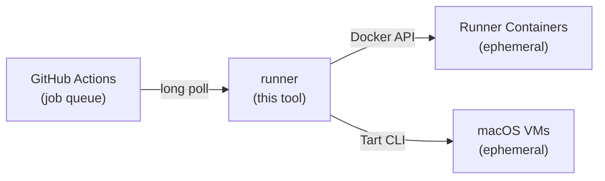

# runner

[](https://github.com/ysya/runscaler/releases)
[](https://go.dev)
[](LICENSE)
[](https://goreportcard.com/report/github.com/ysya/runscaler)

[English](README.md) | [繁體中文](README.zh-TW.md)

Auto-scale GitHub Actions self-hosted runners as Docker containers or macOS VMs. Powered by [actions/scaleset](https://github.com/actions/scaleset).

Runners are **ephemeral** — each container/VM handles exactly one job and is removed upon completion. No Kubernetes required.

## Table of Contents

- [How It Works](#how-it-works)
- [Features](#features)
- [Quick Start](#quick-start)
  - [Prerequisites](#prerequisites)
  - [Install](#install)
  - [Run](#run)
- [Commands](#commands)
- [Documentation](#documentation)
- [Upgrade requirements](#upgrade-requirements)
- [License](#license)

## How It Works



1. Registers a [runner scale set](https://docs.github.com/en/actions/hosting-your-own-runners/managing-self-hosted-runners-with-actions-runner-controller/about-actions-runner-controller) with GitHub
2. Long-polls for job assignments via the scaleset API
3. Spins up Docker containers or macOS VMs with JIT (just-in-time) runner configs
4. Removes containers/VMs automatically when jobs complete
5. Drains in-flight jobs on a graceful stop and reconciles resources left by an abnormal stop at the next startup

## Features

- **Zero Kubernetes** — runs directly on any Docker host or Apple Silicon Mac
- **Ephemeral runners** — each job gets a fresh container/VM, no state leakage
- **Auto-scaling** — scales from 0 to N based on job demand via long-poll (no cron, no polling delay)
- **Docker-in-Docker** — optional DinD support for workflows that build containers
- **macOS VMs via Tart** — native Apple Virtualization.framework with APFS Copy-on-Write cloning
- **Tart networking** — shared NAT by default, with optional host-interface bridging
- **VM warm pool** — pre-boot macOS VMs for instant job pickup (~2s vs ~30s cold boot)
- **Shared volumes** — cross-runner caching via named Docker volumes
- **Multi-org support** — manage multiple scale sets from a single process, mixing Docker and Tart providers
- **Self-healing capacity** — replace containers/VMs that exit before GitHub reports job completion
- **Safe restarts** — SIGTERM/SIGQUIT stop new work and wait for in-flight jobs; startup reclaims containers/VMs left by hard kills
- **Operational safety** — one process per host, localhost-only health checks, and built-in rotating logs
- **Single binary** — no runtime dependencies beyond Docker (or Tart for macOS)
- **Config file or flags** — TOML config with CLI flag overrides

## Quick Start

### Prerequisites

- **Docker provider:** Docker running on the host
- **Tart provider (macOS):** Apple Silicon Mac with [Tart](https://tart.run/) installed:

  ```bash
  # Homebrew 7 refuses formulae from a tap you have not trusted
  brew trust --formula openai/tools/tart openai/tools/softnet
  brew install openai/tools/tart

  # Pull a macOS runner image (pre-installed with Xcode and runner dependencies)
  tart pull ghcr.io/cirruslabs/macos-golden-gate-xcode:latest
  ```

  > **Upgrading from the `cirruslabs/cli` tap:** Tart moved to `openai/tools`, so `brew upgrade` never gets past the last `cirruslabs/cli` release (2.32.x). Run `brew uninstall tart softnet`, then the two commands above, then remove the old tap. Homebrew will not untap formulae it does not trust, so trust them just for that: `brew trust --formula cirruslabs/cli/tart cirruslabs/cli/softnet && brew untap cirruslabs/cli && brew untrust --formula cirruslabs/cli/tart cirruslabs/cli/softnet`. Avoid `brew untap --force`, which uninstalls every formula it attributes to the tap.

  > **Note:** Apple's Virtualization.framework limits each host to **2 concurrent macOS VMs**. Set `max-runners` accordingly. Each VM slot reuses a deterministic MAC address to reduce DHCP lease churn — no sudo required for MAC assignment.

  The default VM resources from Cirrus Labs images:

  | Image | CPU | Memory | Disk |
  | ----- | --- | ------ | ---- |
  | `ghcr.io/cirruslabs/macos-golden-gate-xcode:latest` (macOS 27) | 4 cores | 8 GB (8192 MB) | 140 GB |
  | `ghcr.io/cirruslabs/macos-tahoe-xcode:latest` (macOS 26) | 4 cores | 8 GB (8192 MB) | 140 GB |
  | `ghcr.io/cirruslabs/macos-sequoia-xcode:latest` (macOS 15) | 4 cores | 8 GB (8192 MB) | 140 GB |

  Image tags track the Xcode version, not macOS (e.g. `macos-golden-gate-xcode:27.2` ships Xcode 27.2); pin a tag instead of `latest` for reproducible builds. A guest cannot run a newer macOS than its host, so a macOS 26 host needs `macos-tahoe-xcode`.

  Override per VM with `cpu` and `memory` under `[tart]` in config. For iOS builds (Xcode), 8 GB+ is recommended.

- GitHub credentials: a [GitHub App](docs/configuration.md#github-app-authentication) or a **Personal Access Token**. PAT scopes depend on token type and runner level:

  | Token type           | Organization runners                                               | Repository runners                 |
  | -------------------- | ------------------------------------------------------------------ | ---------------------------------- |
  | **Classic PAT**      | `admin:org`                                                        | `repo`                             |
  | **Fine-grained PAT** | Self-hosted runners: **Read and write** + Administration: **Read** | Administration: **Read and write** |

  > **Note:** The token owner must be an **org owner** (for org runners) or have **admin access** to the repo (for repo runners). Fine-grained PATs targeting an organization may also require [admin approval](https://docs.github.com/en/organizations/managing-programmatic-access-to-your-organization/setting-a-personal-access-token-policy-for-your-organization) depending on org policy.

### Install

**Shell script (Linux/macOS):**

```bash
# Linux: root-owned system binary (the service runs as non-root)
curl -fsSL https://raw.githubusercontent.com/ysya/runscaler/main/install.sh | sudo sh

# macOS: user binary; Linux: opt into a user installation
curl -fsSL https://raw.githubusercontent.com/ysya/runscaler/main/install.sh | sh -s -- --user
```

Linux defaults to system installation at `/usr/local/bin` and requires root. macOS defaults to `~/.local/bin`; Linux `--user` uses the same user-owned location. The script downloads a binary only; it does not create an account or service. System binaries may use another absolute location if the file and every ancestor are protected from non-root writes. Set `INSTALL_DIR` to customize, or `RUNNER_VERSION` to pin a version:

```bash
# Install the system binary elsewhere (the directory and every ancestor must be root-only)
curl -fsSL https://raw.githubusercontent.com/ysya/runscaler/main/install.sh | sudo env INSTALL_DIR=/opt/runner/bin sh

# Pin a specific version
curl -fsSL https://raw.githubusercontent.com/ysya/runscaler/main/install.sh | RUNNER_VERSION=v1.2.3 sh -s -- --user
```

**Go install:**

```bash
go install github.com/ysya/runscaler/cmd/runner@latest
```

**Binary releases:**

Download from [Releases](https://github.com/ysya/runscaler/releases) and add to your `PATH`.

### Run

```bash
# Generate config interactively
# (writes ~/.config/runner/config.toml, or /etc/runner/config.toml as root)
runner init

# Validate everything before starting (the standard config path is found automatically)
runner validate

# Start scaling
runner run

# Or using CLI flags directly
runner run \
  --url https://github.com/your-org \
  --name my-runners \
  --token ghp_xxx \
  --max-runners 10

# Dry run — validate config, Docker, and images without starting listeners
runner run --dry-run
```

Then in your workflow:

```yaml
jobs:
  build:
    runs-on: my-runners  # matches --labels (defaults to --name if not set)
    steps:
      - uses: actions/checkout@v4
      - run: echo "Running on auto-scaled runner!"
```

## Commands

| Command                  | Description                                            |
| ------------------------ | ------------------------------------------------------ |
| `runner run`             | Start the runner manager                               |
| `runner init`            | Generate a config file interactively                   |
| `runner validate`        | Validate configuration and connectivity                |
| `runner status`          | Show capacity, connections, jobs, queues, and disk headroom |
| `runner doctor`          | Diagnose GitHub connectivity and orphaned containers/VMs |
| `runner cache`           | Show disk usage and retention policy for every cache store |
| `runner logs`            | Show/follow runner's rotating log file                  |
| `runner service`         | Install, regenerate (`--force`), start, stop, and inspect the service |
| `runner version`         | Show version, commit, build date, and runtime info     |
| `runner update`          | Update runner to the latest release                    |
| `runner update --check`  | Check for updates without installing                   |
| `runner update --restart` | Update, validate the config and restart the service   |
| `runner scaleset delete` | Remove a retired scale set from GitHub                 |

Details for each command are in [docs/commands.md](docs/commands.md).

## Documentation

| Guide | Covers |
| --- | --- |
| [Commands](docs/commands.md) | Status dashboard, updating, troubleshooting with `doctor`, logs, runner startup and failure recovery |
| [Configuration](docs/configuration.md) | Config file (TOML), GitHub App authentication, token security, CLI flags |
| [Caching](docs/caching.md) | What can be reclaimed, the disk guard, store retention settings, visibility |
| [Security & Isolation](docs/security.md) | Docker socket sharing, per-scale-set isolation settings, Tart VM isolation |
| [Deployment](docs/deployment.md) | Graceful shutdown, service layout, systemd |
| [Development](docs/development.md) | Building from source, architecture |

## Upgrade requirements

The historical rename transition is retired. Releases contain only `runner-*`
archives. The `migrate` command, implicit root `runner --config` startup,
`--backend`, automatic `runscaler` config-directory search, old service names
and `RUNSCALER_TOKEN` fallback are no longer supported. Start the manager with
`runner run --config /absolute/path/config.toml`.

Use the current setting names before upgrading:

| Removed setting | Current setting |
| --- | --- |
| `backend` | `provider` |
| `docker.shared-volume-ttl` | `docker.shared-volume-max-age` |
| `tart.cache-space-budget` | `tart.cache-budget` |
| `RUNSCALER_TOKEN` fallback | `RUNNER_TOKEN` |

Removed TOML keys cause an explicit error; they are never silently translated
or ignored. Rename-era installations need manual preparation of their binary,
config and service definition before upgrading to this version. Existing data
and old backup files are left untouched. Current `runner` system services that
run as root remain supported and keep that identity through update/--force.

For standalone commands, config discovery checks the working directory, the
current user's runner config directory, then `/etc/runner`. Explicit `--config`
selects its exact path. Absolute `XDG_CONFIG_HOME` and `XDG_STATE_HOME` customize
user config/state; relative values are ignored. User service installation
records those values and its absolute config path, while management commands
select the installed service's config. `init` defaults to the current identity's
standard config path; `service install --config-path` takes precedence over
`--config`.

## License

MIT
