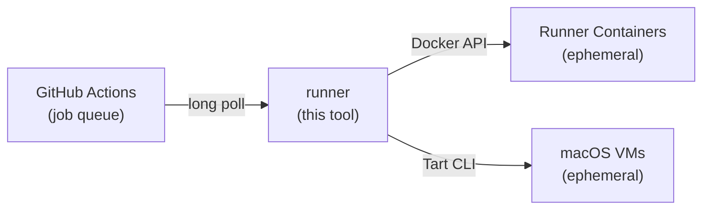

# runner

[](https://github.com/ysya/runscaler/releases)
[](https://go.dev)
[](LICENSE)
[](https://goreportcard.com/report/github.com/ysya/runscaler)

[English](README.md) | [繁體中文](README.zh-TW.md)

本文件為 [英文 README](README.md) 的繁體中文版本。更新指令、設定或操作說明時，請同步維護英文與繁體中文版本（包含 `docs/` 內的文件）；若內容有差異，以英文版為準。

以 Docker 容器或 macOS VM 自動擴縮 GitHub Actions 自架 runner。採用 [actions/scaleset](https://github.com/actions/scaleset)。

runner 採用**短生命週期**模式 — 每個容器／VM 只處理一個工作，完成後便會移除。不需要 Kubernetes。

<a id="table-of-contents"></a>

## 目錄

- [運作方式](#how-it-works)
- [功能](#features)
- [快速開始](#quick-start)
  - [必要條件](#prerequisites)
  - [安裝](#install)
  - [執行](#run)
- [指令](#commands)
- [文件](#documentation)
- [升級前準備](#upgrade-requirements)
- [授權條款](#license)

<a id="how-it-works"></a>

## 運作方式



1. 向 GitHub 註冊 [runner 規模集](https://docs.github.com/en/actions/hosting-your-own-runners/managing-self-hosted-runners-with-actions-runner-controller/about-actions-runner-controller)
2. 透過 scaleset API 以長輪詢接收工作指派
3. 使用 JIT（just-in-time，即時產生）runner 設定啟動 Docker 容器或 macOS VM
4. 工作完成後自動移除容器／VM
5. 正常停止時排空執行中的工作；若異常停止，則於下次啟動時清理遺留的資源

<a id="features"></a>

## 功能

- **不需 Kubernetes** — 可直接在任何 Docker 主機或 Apple Silicon Mac 上執行
- **短生命週期 runner** — 每個工作都使用全新的容器／VM，不會殘留前一個工作的狀態
- **自動擴縮** — 透過長輪詢依工作需求在 0 到 N 個 runner 之間擴縮（不需 cron，也沒有定期輪詢的延遲）
- **Docker-in-Docker** — 可選用 DinD，支援需要建置容器的工作流程
- **透過 Tart 執行 macOS VM** — 使用原生 Apple Virtualization.framework，搭配 APFS 寫入時複製（Copy-on-Write）複製機制
- **Tart 網路** — 預設使用共用 NAT，也可選擇橋接至主機網路介面
- **VM 預熱集區** — 預先啟動 macOS VM，即時接手工作（約 2 秒，冷啟動則約需 30 秒）
- **共用磁碟區** — 透過具名 Docker 磁碟區在 runner 之間共用快取
- **支援多個組織** — 單一程序即可管理多個 runner 規模集，並混用 Docker 與 Tart 供應器
- **容量自我修復** — 若容器／VM 在 GitHub 回報工作完成前退出，會自動補上
- **安全重新啟動** — SIGTERM／SIGQUIT 會停止接收新工作並等待執行中的工作完成；啟動時會回收強制終止後遺留的容器／VM
- **維運安全性** — 每台主機僅允許一個程序、健康檢查僅限 localhost 存取，並內建輪替日誌
- **單一執行檔** — 除 Docker（或 macOS 上的 Tart）外，沒有其他執行階段相依項目
- **設定檔或旗標** — 支援 TOML 設定，並可透過 CLI 旗標覆寫

<a id="quick-start"></a>

## 快速開始

<a id="prerequisites"></a>

### 必要條件

- **Docker 供應器：** 主機上須已執行 Docker
- **Tart 供應器（macOS）：** 已安裝 [Tart](https://tart.run/) 的 Apple Silicon Mac：

  ```bash
  # Homebrew 7 refuses formulae from a tap you have not trusted
  brew trust --formula openai/tools/tart openai/tools/softnet
  brew install openai/tools/tart

  # Pull a macOS runner image (pre-installed with Xcode and runner dependencies)
  tart pull ghcr.io/cirruslabs/macos-golden-gate-xcode:latest
  ```

  > **從 `cirruslabs/cli` tap 升級：** Tart 已移至 `openai/tools`，因此 `brew upgrade` 只能更新到 `cirruslabs/cli` 的最後一個版本（2.32.x）。請先執行 `brew uninstall tart softnet`，再執行上方兩個指令，最後移除舊 tap。Homebrew 不允許移除含有未受信任 formula 的 tap，因此僅為了移除而暫時信任這些 formula：`brew trust --formula cirruslabs/cli/tart cirruslabs/cli/softnet && brew untap cirruslabs/cli && brew untrust --formula cirruslabs/cli/tart cirruslabs/cli/softnet`。避免使用 `brew untap --force`，因為它會解除安裝所有被歸屬於該 tap 的 formula。

  > **注意：** Apple 的 Virtualization.framework 限制每台主機**同時最多執行 2 台 macOS VM**。請據此設定 `max-runners`。每個 VM 槽位會重複使用固定的 MAC 位址，以減少 DHCP 租約更動；指派 MAC 位址不需要 sudo。

  Cirrus Labs 映像檔的預設 VM 資源：

  | 映像檔 | CPU | 記憶體 | 磁碟 |
  | ----- | --- | ------ | ---- |
  | `ghcr.io/cirruslabs/macos-golden-gate-xcode:latest`（macOS 27） | 4 核心 | 8 GB（8192 MB） | 140 GB |
  | `ghcr.io/cirruslabs/macos-tahoe-xcode:latest`（macOS 26） | 4 核心 | 8 GB（8192 MB） | 140 GB |
  | `ghcr.io/cirruslabs/macos-sequoia-xcode:latest`（macOS 15） | 4 核心 | 8 GB（8192 MB） | 140 GB |

  映像檔標籤對應的是 Xcode 版本而非 macOS 版本（例如 `macos-golden-gate-xcode:27.2` 內含 Xcode 27.2）；若需要可重現的建置，請固定標籤而非使用 `latest`。VM 的 macOS 版本不能比主機新，因此 macOS 26 主機請使用 `macos-tahoe-xcode`。

  可在設定檔的 `[tart]` 下，透過 `cpu` 與 `memory` 覆寫每台 VM 的資源。進行 iOS 建置（Xcode）時，建議至少配置 8 GB 記憶體。

- GitHub 憑證：[GitHub App](docs/configuration.zh-TW.md#github-app-authentication) 或**個人存取權杖（Personal Access Token）**。PAT 所需的權限範圍取決於權杖類型與 runner 層級：

  | 權杖類型 | 組織 runner | 儲存庫 runner |
  | -------------------- | ------------------------------------------------------------------ | ---------------------------------- |
  | **傳統 PAT** | `admin:org` | `repo` |
  | **細緻權限 PAT** | 自架 runner：**讀取與寫入** + 管理：**讀取** | 管理：**讀取與寫入** |

  > **注意：** 權杖擁有者必須是**組織擁有者**（組織 runner），或具有儲存庫的**管理員存取權**（儲存庫 runner）。依組織原則而定，以組織為目標的細緻權限 PAT 也可能需要[管理員核准](https://docs.github.com/en/organizations/managing-programmatic-access-to-your-organization/setting-a-personal-access-token-policy-for-your-organization)。

<a id="install"></a>

### 安裝

**Shell 指令碼（Linux／macOS）：**

```bash
# Linux: root-owned system binary (the service runs as non-root)
curl -fsSL https://raw.githubusercontent.com/ysya/runscaler/main/install.sh | sudo sh

# macOS: user binary; Linux: opt into a user installation
curl -fsSL https://raw.githubusercontent.com/ysya/runscaler/main/install.sh | sh -s -- --user
```

Linux 預設為系統安裝，需以 root 將 binary 安裝至 `/usr/local/bin`。macOS 預設安裝至 `~/.local/bin`；Linux 的 `--user` 也使用此使用者路徑。指令碼只下載 binary，不會建立帳號或服務。系統 binary 也可使用其他絕對路徑，但檔案與所有上層目錄都必須只有 root 能修改。可設定 `INSTALL_DIR` 自訂位置，或以 `RUNNER_VERSION` 指定版本：

```bash
# Install the system binary elsewhere (the directory and every ancestor must be root-only)
curl -fsSL https://raw.githubusercontent.com/ysya/runscaler/main/install.sh | sudo env INSTALL_DIR=/opt/runner/bin sh

# Pin a specific version
curl -fsSL https://raw.githubusercontent.com/ysya/runscaler/main/install.sh | RUNNER_VERSION=v1.2.3 sh -s -- --user
```

**透過 Go 安裝：**

```bash
go install github.com/ysya/runscaler/cmd/runner@latest
```

**預先編譯的執行檔：**

從[發行版本](https://github.com/ysya/runscaler/releases)下載，並加入你的 `PATH`。

<a id="run"></a>

### 執行

```bash
# Generate config interactively
# (writes ~/.config/runner/config.toml, or /etc/runner/config.toml as root)
runner init

# Validate everything before starting (the standard config path is found automatically)
runner validate

# Start scaling
runner run

# Or using CLI flags directly
runner run \
  --url https://github.com/your-org \
  --name my-runners \
  --token ghp_xxx \
  --max-runners 10

# Dry run — validate config, Docker, and images without starting listeners
runner run --dry-run
```

接著在工作流程中設定：

```yaml
jobs:
  build:
    runs-on: my-runners  # matches --labels (defaults to --name if not set)
    steps:
      - uses: actions/checkout@v4
      - run: echo "Running on auto-scaled runner!"
```

<a id="commands"></a>

## 指令

| 指令 | 說明 |
| ------------------------ | ------------------------------------------------------ |
| `runner run` | 啟動 runner 管理程序 |
| `runner init` | 互動式產生設定檔 |
| `runner validate` | 驗證設定與連線 |
| `runner status` | 顯示容量、工作、原生快取與磁碟剩餘空間 |
| `runner doctor` | 診斷 GitHub 連線與孤立的容器／VM |
| `runner cache` | 顯示各快取儲存區的磁碟用量與保留原則 |
| `runner logs` | 顯示／持續追蹤 runner 的輪替日誌檔 |
| `runner service` | 安裝、重新產生（`--force`）、啟動、停止與檢查服務 |
| `runner version` | 顯示版本、提交、建置日期與執行階段資訊 |
| `runner update` | 將 runner 更新至最新發行版本 |
| `runner update --check` | 檢查更新但不安裝 |
| `runner update --restart` | 更新、驗證設定並重啟服務 |
| `runner scaleset delete` | 從 GitHub 移除已停用的 runner 規模集 |

各指令的詳細說明請見 [docs/commands.zh-TW.md](docs/commands.zh-TW.md)。

<a id="documentation"></a>

## 文件

| 文件 | 內容 |
| --- | --- |
| [指令](docs/commands.zh-TW.md) | 狀態儀表板、更新、使用 `doctor` 疑難排解、日誌、Runner 啟動與失敗復原 |
| [設定](docs/configuration.zh-TW.md) | 設定檔（TOML）、GitHub App 驗證、權杖安全性、CLI 旗標 |
| [快取](docs/caching.zh-TW.md) | 哪些資料可以回收、磁碟防護機制、儲存區保留設定、檢視空間使用情況 |
| [安全性與隔離](docs/security.zh-TW.md) | 共用 Docker socket 的風險、各 runner 規模集的隔離設定、Tart VM 隔離 |
| [部署](docs/deployment.zh-TW.md) | 正常關閉、服務配置、Systemd |
| [開發](docs/development.zh-TW.md) | 建置、架構 |

<a id="upgrade-requirements"></a>

## 升級前準備

歷史更名相容期已結束。後續 release 僅產出 `runner-*` 壓縮檔，不再支援 `migrate` 指令、根指令 `runner --config` 直接啟動、`--backend`、自動搜尋 `runscaler` 設定目錄、舊服務名稱與 `RUNSCALER_TOKEN` 備援。啟動 manager 請使用 `runner run --config /absolute/path/config.toml`。

升級前請改用目前的設定名稱：

| 已移除設定 | 目前設定 |
| --- | --- |
| `backend` | `provider` |
| `docker.shared-volume-ttl` | `docker.shared-volume-max-age` |
| `tart.cache-space-budget` | `tart.cache-budget` |
| `RUNSCALER_TOKEN` 備援 | `RUNNER_TOKEN` |

已移除的 TOML 設定鍵會明確報錯，不會自動翻譯或忽略。仍使用更名過渡期格式的安裝，須先手動準備目前的 binary、config 與服務定義，再升級至此版本。既有資料與舊備份檔案保持原樣。已使用目前 `runner` 格式的 Linux root 系統服務仍受支援，更新與 `--force` 都保留原身分。

獨立執行時，設定搜尋順序為目前目錄、目前使用者的 runner 設定目錄、`/etc/runner`；明確指定 `--config` 時使用該路徑。絕對路徑的 `XDG_CONFIG_HOME` 與 `XDG_STATE_HOME` 可自訂 user 設定／state 位置，相對值會被忽略。user 服務安裝會記錄這些變數與設定檔的絕對路徑，管理指令則使用已安裝服務的設定。`init` 預設使用目前身分的標準設定路徑；服務安裝時 `--config-path` 優先於 `--config`。

<a id="license"></a>

## 授權條款

MIT
