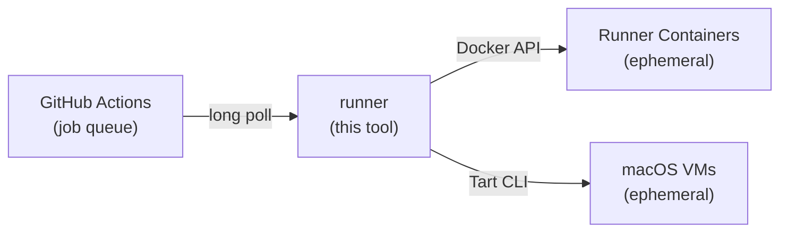

# runner

[](https://github.com/ysya/runscaler/releases)
[](https://go.dev)
[](LICENSE)
[](https://goreportcard.com/report/github.com/ysya/runscaler)

[English](README.md) | [繁體中文](README.zh-TW.md)

本文件為 [英文 README](README.md) 的繁體中文版本。更新指令、設定或操作說明時，請同步維護兩份文件；若內容有差異，以英文版為準。

以 Docker 容器或 macOS VM 自動擴縮 GitHub Actions 自架 runner。採用 [actions/scaleset](https://github.com/actions/scaleset)。

runner 採用**短生命週期**模式 — 每個容器／VM 只處理一個工作，完成後便會移除。不需要 Kubernetes。

<a id="table-of-contents"></a>

## 目錄

- [運作方式](#how-it-works)
- [功能](#features)
- [快速開始](#quick-start)
  - [必要條件](#prerequisites)
  - [安裝](#install)
  - [執行](#run)
- [指令](#commands)
  - [更新](#updating)
- [設定](#configuration)
  - [設定檔（TOML）](#config-file-toml)
  - [GitHub App 驗證](#github-app-authentication)
  - [權杖安全性](#token-security)
  - [CLI 旗標](#cli-flags)
- [快取](#caching)
  - [可回收的項目](#what-can-be-reclaimed)
  - [磁碟防護機制](#the-disk-guard)
  - [儲存區保留設定](#store-retention-settings)
  - [檢視空間使用情況](#visibility)
- [安全性與隔離](#security--isolation)
- [部署](#deployment)
  - [正常關閉](#graceful-shutdown)
- [建置](#building)
- [架構](#architecture)
- [升級前準備](#upgrade-requirements)
- [授權條款](#license)

<a id="how-it-works"></a>

## 運作方式



1. 向 GitHub 註冊 [runner 規模集](https://docs.github.com/en/actions/hosting-your-own-runners/managing-self-hosted-runners-with-actions-runner-controller/about-actions-runner-controller)
2. 透過 scaleset API 以長輪詢接收工作指派
3. 使用 JIT（just-in-time，即時產生）runner 設定啟動 Docker 容器或 macOS VM
4. 工作完成後自動移除容器／VM
5. 正常停止時排空執行中的工作；若異常停止，則於下次啟動時清理遺留的資源

<a id="features"></a>

## 功能

- **不需 Kubernetes** — 可直接在任何 Docker 主機或 Apple Silicon Mac 上執行
- **短生命週期 runner** — 每個工作都使用全新的容器／VM，不會殘留前一個工作的狀態
- **自動擴縮** — 透過長輪詢依工作需求在 0 到 N 個 runner 之間擴縮（不需 cron，也沒有定期輪詢的延遲）
- **Docker-in-Docker** — 可選用 DinD，支援需要建置容器的工作流程
- **透過 Tart 執行 macOS VM** — 使用原生 Apple Virtualization.framework，搭配 APFS 寫入時複製（Copy-on-Write）複製機制
- **Tart 網路** — 預設使用共用 NAT，也可選擇橋接至主機網路介面
- **VM 預熱集區** — 預先啟動 macOS VM，即時接手工作（約 2 秒，冷啟動則約需 30 秒）
- **共用磁碟區** — 透過具名 Docker 磁碟區在 runner 之間共用快取
- **支援多個組織** — 單一程序即可管理多個 runner 規模集，並混用 Docker 與 Tart 供應器
- **容量自我修復** — 若容器／VM 在 GitHub 回報工作完成前退出，會自動補上
- **安全重新啟動** — SIGTERM／SIGQUIT 會停止接收新工作並等待執行中的工作完成；啟動時會回收強制終止後遺留的容器／VM
- **維運安全性** — 每台主機僅允許一個程序、健康檢查僅限 localhost 存取，並內建輪替日誌
- **單一執行檔** — 除 Docker（或 macOS 上的 Tart）外，沒有其他執行階段相依項目
- **設定檔或旗標** — 支援 TOML 設定，並可透過 CLI 旗標覆寫

<a id="quick-start"></a>

## 快速開始

<a id="prerequisites"></a>

### 必要條件

- **Docker 供應器：** 主機上須已執行 Docker
- **Tart 供應器（macOS）：** 已安裝 [Tart](https://tart.run/) 的 Apple Silicon Mac：

  ```bash
  # Homebrew 7 refuses formulae from a tap you have not trusted
  brew trust --formula openai/tools/tart openai/tools/softnet
  brew install openai/tools/tart

  # Pull a macOS runner image (pre-installed with Xcode and runner dependencies)
  tart pull ghcr.io/cirruslabs/macos-golden-gate-xcode:latest
  ```

  > **從 `cirruslabs/cli` tap 升級：** Tart 已移至 `openai/tools`，因此 `brew upgrade` 只能更新到 `cirruslabs/cli` 的最後一個版本（2.32.x）。請先執行 `brew uninstall tart softnet`，再執行上方兩個指令，最後移除舊 tap。Homebrew 不允許移除含有未受信任 formula 的 tap，因此僅為了移除而暫時信任這些 formula：`brew trust --formula cirruslabs/cli/tart cirruslabs/cli/softnet && brew untap cirruslabs/cli && brew untrust --formula cirruslabs/cli/tart cirruslabs/cli/softnet`。避免使用 `brew untap --force`，因為它會解除安裝所有被歸屬於該 tap 的 formula。

  > **注意：** Apple 的 Virtualization.framework 限制每台主機**同時最多執行 2 台 macOS VM**。請據此設定 `max-runners`。每個 VM 槽位會重複使用固定的 MAC 位址，以減少 DHCP 租約更動；指派 MAC 位址不需要 sudo。

  Cirrus Labs 映像檔的預設 VM 資源：

  | 映像檔 | CPU | 記憶體 | 磁碟 |
  | ----- | --- | ------ | ---- |
  | `ghcr.io/cirruslabs/macos-golden-gate-xcode:latest`（macOS 27） | 4 核心 | 8 GB（8192 MB） | 140 GB |
  | `ghcr.io/cirruslabs/macos-tahoe-xcode:latest`（macOS 26） | 4 核心 | 8 GB（8192 MB） | 140 GB |
  | `ghcr.io/cirruslabs/macos-sequoia-xcode:latest`（macOS 15） | 4 核心 | 8 GB（8192 MB） | 140 GB |

  映像檔標籤對應的是 Xcode 版本而非 macOS 版本（例如 `macos-golden-gate-xcode:27.2` 內含 Xcode 27.2）；若需要可重現的建置，請固定標籤而非使用 `latest`。VM 的 macOS 版本不能比主機新，因此 macOS 26 主機請使用 `macos-tahoe-xcode`。

  可在設定檔的 `[tart]` 下，透過 `cpu` 與 `memory` 覆寫每台 VM 的資源。進行 iOS 建置（Xcode）時，建議至少配置 8 GB 記憶體。

- GitHub 憑證：[GitHub App](#github-app-authentication) 或**個人存取權杖（Personal Access Token）**。PAT 所需的權限範圍取決於權杖類型與 runner 層級：

  | 權杖類型 | 組織 runner | 儲存庫 runner |
  | -------------------- | ------------------------------------------------------------------ | ---------------------------------- |
  | **傳統 PAT** | `admin:org` | `repo` |
  | **細緻權限 PAT** | 自架 runner：**讀取與寫入** + 管理：**讀取** | 管理：**讀取與寫入** |

  > **注意：** 權杖擁有者必須是**組織擁有者**（組織 runner），或具有儲存庫的**管理員存取權**（儲存庫 runner）。依組織原則而定，以組織為目標的細緻權限 PAT 也可能需要[管理員核准](https://docs.github.com/en/organizations/managing-programmatic-access-to-your-organization/setting-a-personal-access-token-policy-for-your-organization)。

<a id="install"></a>

### 安裝

**Shell 指令碼（Linux／macOS）：**

```bash
# Linux: root-owned system binary (the service runs as non-root)
curl -fsSL https://raw.githubusercontent.com/ysya/runscaler/main/install.sh | sudo sh

# macOS: user binary; Linux: opt into a user installation
curl -fsSL https://raw.githubusercontent.com/ysya/runscaler/main/install.sh | sh -s -- --user
```

Linux 預設為系統安裝，需以 root 將 binary 安裝至 `/usr/local/bin`。macOS 預設安裝至 `~/.local/bin`；Linux 的 `--user` 也使用此使用者路徑。指令碼只下載 binary，不會建立帳號或服務。系統 binary 也可使用其他絕對路徑，但檔案與所有上層目錄都必須只有 root 能修改。可設定 `INSTALL_DIR` 自訂位置，或以 `RUNNER_VERSION` 指定版本：

```bash
# Install the system binary elsewhere (the directory and every ancestor must be root-only)
curl -fsSL https://raw.githubusercontent.com/ysya/runscaler/main/install.sh | sudo env INSTALL_DIR=/opt/runner/bin sh

# Pin a specific version
curl -fsSL https://raw.githubusercontent.com/ysya/runscaler/main/install.sh | RUNNER_VERSION=v1.2.3 sh -s -- --user
```

**透過 Go 安裝：**

```bash
go install github.com/ysya/runscaler/cmd/runner@latest
```

**預先編譯的執行檔：**

從[發行版本](https://github.com/ysya/runscaler/releases)下載，並加入你的 `PATH`。

<a id="run"></a>

### 執行

```bash
# Generate config interactively
# (writes ~/.config/runner/config.toml, or /etc/runner/config.toml as root)
runner init

# Validate everything before starting (the standard config path is found automatically)
runner validate

# Start scaling
runner run

# Or using CLI flags directly
runner run \
  --url https://github.com/your-org \
  --name my-runners \
  --token ghp_xxx \
  --max-runners 10

# Dry run — validate config, Docker, and images without starting listeners
runner run --dry-run
```

接著在工作流程中設定：

```yaml
jobs:
  build:
    runs-on: my-runners  # matches --labels (defaults to --name if not set)
    steps:
      - uses: actions/checkout@v4
      - run: echo "Running on auto-scaled runner!"
```

<a id="commands"></a>

## 指令

| 指令 | 說明 |
| ------------------------ | ------------------------------------------------------ |
| `runner run` | 啟動 runner 管理程序 |
| `runner init` | 互動式產生設定檔 |
| `runner validate` | 驗證設定與連線 |
| `runner status` | 顯示容量、連線、工作、佇列與磁碟剩餘空間 |
| `runner doctor` | 診斷 GitHub 連線與孤立的容器／VM |
| `runner cache` | 顯示各快取儲存區的磁碟用量與保留原則 |
| `runner logs` | 顯示／持續追蹤 runner 的輪替日誌檔 |
| `runner service` | 安裝、重新產生（`--force`）、啟動、停止與檢查服務 |
| `runner version` | 顯示版本、提交、建置日期與執行階段資訊 |
| `runner update` | 將 runner 更新至最新發行版本 |
| `runner update --check` | 檢查更新但不安裝 |
| `runner scaleset delete` | 從 GitHub 移除已停用的 runner 規模集 |

<a id="status-dashboard"></a>

### 狀態儀表板

`runner status` 會將本機 `/healthz` 快照轉為便於維運人員閱讀的儀表板。
摘要會彙整就緒的 runner 規模集、runner 生命週期（`provisioning`、`idle`、`busy`、`removing`）、
期望的 runner 數量、佇列深度，以及程序執行期間累計的工作計數。
此外，也會以 `in_use / limit` 顯示整台主機的 `concurrent` 容量。
接著，各 runner 規模集會分別顯示連線狀態、上次成功連線時間與最近一次錯誤。
磁碟區段會顯示可快速取得的檔案系統剩餘空間；若需要較耗時的各儲存區用量測量，請使用 `runner cache`。

```bash
# Human-readable dashboard; color is enabled automatically in a terminal
runner status

# Stable machine-readable health response
runner status --json

# Plain dashboard for logs or terminals where color is undesirable
runner status --no-color
```

`/healthz`（以及 `status --json`）中各 runner 規模集的選用 `runtime` 物件，
會回報啟動嘗試次數、失敗次數、連續失敗次數、上次嘗試與成功啟動時間、
等待全域容量的狀態，以及排空狀態。計數器的有效期間為管理程序的生命週期。
若缺少啟動時間戳記，表示尚未記錄過該事件。失敗原因會使用安全的分類
（`jit_config_failed` 或 `provider_start_failed`），不會包含供應器的原始錯誤或憑證值。

`/healthz` 仍是存活檢查端點，會回傳 HTTP 200。當監聽器中斷連線、
控制器正在排空，或啟動失敗後仍有未滿足的需求時，其 JSON `status` 會變成 `degraded`，
而 `/readyz` 會回傳 HTTP 503。尚未完成的重試不會恢復就緒狀態；成功啟動後才會恢復。
正常等待主機全域容量、縮減至零，以及需求消失後留下的歷史失敗紀錄，都不視為故障。
取得執行階段快照不會向供應器或 GitHub 發出請求。儀表板會以 `ERROR`、
`WAITING FOR CAPACITY` 或 `DRAINING` 說明這些狀態，並附上啟動計數與時間戳記。

<a id="updating"></a>

### 更新

替換現有安裝前，請先閱讀[升級前準備](#upgrade-requirements)與目標版本的發行說明。
舊指令、設定名稱與憑證環境變數可能需要先手動調整。

```bash
# Check for a release and review its upgrade requirements without installing
runner update --check

# After preparing the installation, update its selected binary
runner update
```

`runner update` 會顯示選定服務的安裝範圍、執行身分、binary 與設定檔，下載適合平台的
封存檔、驗證 `checksums.txt` 中的 SHA-256，再以不可分割的操作替換 binary。
這個流程不會驗證設定／provider 相容性、重寫服務定義或重啟服務；既有 system／user
範圍與執行身分會保留，原本以 root 執行的服務不會被轉成非 root 帳號。

安裝後會列出針對實際設定檔的驗證指令，請在服務使用的憑證、provider 存取權限與群組
環境下執行。重啟提示會使用選定 binary 與明確的 `--scope user|system`；system 服務
管理需使用管理員 shell。健康端點回報相同版本，不代表設定相容性或就緒狀態已驗證。
健康端點停用或無法連線時，會明示執行版本未確認，不會假定服務已停止。
使用 `--binary-path` 或沒有安裝服務時，不會選取服務；驗證後請手動重啟使用該 binary 的程序。

SIGTERM 通常會開始排空並等待工作完成，但仍受 `drain-timeout` 與服務管理器停止期限限制。
停用排空或任一期限到期時，工作可能被終止；重啟前請先確認這些設定。

上述提示來自目前已安裝的更新器；舊更新器在第一次升級時無法顯示新加入的警告。
首次跨越這次變更時，請先備份原 binary 與設定檔，將新版下載並解壓至另一個路徑，
在預定執行環境中用新 binary 驗證現有設定，再替換服務使用的 binary：

```bash
/path/to/new/runner validate --config /absolute/path/config.toml
```

runner 規模集在重新啟動期間會維持註冊，因此當 runner 因升級、重新開機或當機而停止時，
排入佇列的工作會在 runner 重新連線後立即被接手。
runner 不會自行刪除 runner 規模集：當你停用某個 `[[scaleset]]` 時，
請先停止 runner，再使用 `runner scaleset delete <name>` 從 GitHub 移除它。

<a id="troubleshooting-with-doctor"></a>

### 使用 `doctor` 疑難排解

若 runner 意外終止（例如 `kill -9`、當機或斷電），可能會遺留 Docker 容器或 Tart VM。
下次執行 `runner run` 時，會在取得整台機器共用的鎖定後自動清理這些資源。
若要手動檢查，請在 runner 停止時使用 `doctor`：

```bash
# Check GitHub API connectivity and orphaned resources
runner doctor

# Auto-remove orphaned containers and VMs
runner doctor --fix
```

Doctor 會使用各個已設定 runner 規模集的 App 或 PAT 憑證探測 GitHub API、
解析其 runner 群組，並查詢其註冊狀態。每次探測的逾時時間為五秒；
即使失敗，也不會阻止後續探測或本機資源檢查。取消操作會停止後續探測。
若 runner 規模集尚未註冊，僅會回報狀態，不會建立或修改它。

即使沒有孤立資源，API 檢查失敗仍會讓指令以失敗狀態結束。
報告僅包含安全的取消、逾時、DNS、TLS 或數字 HTTP 狀態分類，
不會輸出原始 SDK 回應本文。

`--fix` 旗標會取得與 `runner run` 相同的全機鎖定，因此只要目前仍有 runner 執行個體
正在執行，就會拒絕移除資源。
啟動時的資源清理或 `doctor --fix` 都不會移除共用磁碟區與快取磁碟區：
這些磁碟區原本就會保留至程序結束之後，而且可能仍包含執行中工作流程的後續工作所需的資料。

啟動時的資源清理與 `doctor` 採用相同的辨識規則：容器須帶有 `managed-by=runner` 標籤，或名稱正好是 `runner-<8 位十六進位>`；本機 Tart VM 的名稱須正好符合 runner 產生的 `runner-`、`pool-` 或 `runner-keep-` 格式。其餘資源無論叫什麼名字都不會被移除。

<a id="logs"></a>

### 日誌

`runner run` 會將日誌寫入 stdout 與輪替檔案（10 MB，另保留一份備份）。
檔案的預設位置取決於執行身分：

| 執行身分 | 日誌檔 |
| --- | --- |
| Linux 系統服務（專用帳號或 root），或 `sudo runner run` | `/var/log/runner/runner.log` |
| Linux 使用者 | `$XDG_STATE_HOME/runner/runner.log`（`~/.local/state/runner/runner.log`） |
| macOS 使用者 | `~/Library/Logs/runner/runner.log` |

可將 `log-file` 設為明確的路徑，或使用 `log-file = ""` 停用檔案日誌。
以 root 執行時，`log-file` 必須位於 `/var/log` 下的目錄，且目錄名稱僅能使用
英文字母、數字、`.`、`_` 或 `-`；若不符合，會改用預設位置並發出警告。
v0.10 之前的版本會將 `runner.log` 寫在設定檔旁，該檔案會保留在原處。

只有 stdout 是終端機時，stdout 上的日誌輸出才會使用色彩；在 systemd、launchd、
未加 `-t` 的 `docker run`、CI 或管線中，則維持純文字。日誌檔一律不包含色彩控制碼。
可設定 `NO_COLOR=1` 關閉色彩，或設定 `CLICOLOR_FORCE=1` 強制啟用色彩。

```bash
runner logs                 # last 100 lines (add sudo for a system service)
runner logs -n 500 -f
```

每台主機只能有一個 `runner run` 程序在執行。請在該程序中使用多個 `[[scaleset]]`
項目，納入所有組織或儲存庫。
### Runner 啟動與失敗復原

Docker runner 會保持 provisioning，直到日誌出現 `Listening for Jobs`，且容器再存活五秒。
GitHub 的工作指派或完成事件也能證明啟動成功。預設等待五分鐘；可用
`docker.ready-timeout` 調整。自訂 entrypoint 無法輸出該訊息時，可明確設定
`docker.readiness = false`；狀態會顯示 `unverified` 並記錄警告。
Docker 用戶端以非 root 執行，不代表 Docker daemon 本身是 rootless。

啟動失敗後，第一次等待 2.5–5 秒，之後加倍並限制於 `retry.max`（預設一分鐘）；
連續失敗五次後，進入五分鐘冷卻。可在全域預設或個別規模集的 `[retry]` 設定
`initial`、`max`、`cooldown-after`、`cooldown`。新的需求回呼無法繞過期限，
佇列為空時仍會補足最低 runner 數。確認復原只會重設對應的失敗 generation。
Tart 暖池各 slot 分別記錄重試；工作執行期間退出與清理重試不會累加啟動失敗。
`runner status` 與健康 JSON 會顯示就緒狀態、重試期限及安全的失敗資訊。

失敗診斷預設啟用，放在實際開啟的日誌檔旁的 `diagnostics/`，包含 fallback 路徑。
停用檔案日誌時使用該安裝範圍的預設日誌目錄。目錄與檔案權限分別為 0700、0600，
最多保留 20 份、2 MiB、七天，記錄已知的退出碼、OOM 與結束時間；未知值保持未知。
清理失敗時保留容量，直到成功移除。無法確認 GitHub 身分的 runner，會保留到工作事件
允許清理或明確強制關機。

原始日誌預設不收集。設定 `diagnostics.capture-logs = true` 才會收集節錄
（最多 100 行、64 KiB），並遮罩已知 PAT／JIT、Authorization 標頭與 PEM 區塊。
這無法辨識所有工作流程機密；工作可能輸出敏感資料時請維持關閉。
`diagnostics.enabled = false` 可停用診斷報告。健康 JSON 不會包含原始日誌，
診斷收集或寫入失敗也不會阻止清理。

<a id="configuration"></a>

## 設定

可透過 TOML 設定檔（`--config`）或 CLI 旗標提供設定。兩者同時提供時，CLI 旗標的優先順序高於設定檔中的值。

未知的設定鍵（例如拼字錯誤或其他版本的選項）不會被無聲忽略：`runner run` 會逐一記錄警告並繼續啟動，`runner validate` 則會判定失敗。若已有 `[[scaleset]]` 項目，卻仍將單一模式的設定鍵（`url`、`name`、`token`、`github-app`、`labels`、`min-runners`）留在最上層，也會採取相同處理。

<a id="config-file-toml"></a>

### 設定檔（TOML）

**Docker 供應器（預設）：**

```toml
# config.toml
url = "https://github.com/your-org"
name = "my-runners"
token = "ghp_xxx"
max-runners = 10
min-runners = 0
labels = ["self-hosted", "linux"]
runner-image = "ghcr.io/actions/actions-runner:latest"
runner-group = "default"
log-level = "info"
log-format = "text"
concurrent = 10                          # host-wide across all scale sets; 0 = automatic sum
# log-file = "/var/log/runner/runner.log" # default: /var/log/runner/runner.log (root), ~/.local/state/runner/runner.log (Linux), ~/Library/Logs/runner/runner.log (macOS); "" disables
health-address = "127.0.0.1"              # localhost-only by default
health-port = 8080
# drain-timeout = "2h"                    # 0s disables graceful drain

[docker]
socket = "/var/run/docker.sock"
dind = true
shared-volume = "/shared"
# shared-volume-max-age = "168h"        # delete shared-volume files older than this; unset = never reclaimed
# buildx-cleanup = true                 # opt in only on a runner-dedicated daemon
# buildx-cleanup-ttl = "24h"            # remove buildx builders older than this
# buildx-cleanup-interval = "6h"        # how often the buildx sweep runs
# prune = true                          # opt in only on a runner-dedicated daemon
# prune-interval = "6h"                 # how often the runtime prune sweep runs
# prune-ttl = "24h"                     # remove stopped containers and dangling images older than this
# build-cache-max-age = "168h"          # prune build cache entries not used within this window
# build-cache-budget = 0                # cap daemon build cache to N GB (0 = no cap)
```

當 runner 使用 `docker buildx` 建置映像檔（例如透過 `docker/setup-buildx-action`）時，每次執行都可能留下 BuildKit builder 容器，以及容量達數 GB 的 `buildx_buildkit_*_state` 磁碟區。在持續運作、共用同一個 Docker daemon 的主機上，這些資源會不斷累積，直到磁碟空間耗盡。若 daemon 專供 runner 使用，可設定 `buildx-cleanup = true` 啟用清理；runner 接著會移除建立時間超過 `buildx-cleanup-ttl` 的 builder。若持續保留的 builder 或其他工作負載也共用該 daemon，請勿啟用。

除了 buildx builder，每次建置時，掛載主機 Docker socket 的工作也會留下懸空映像檔、已停止的容器與 daemon 建置快取。執行期間的 prune 清理作業（透過 `prune = true` 啟用）會在 runner 運作時定期回收這些資源：建立時間超過 `prune-ttl` 的已停止容器與懸空映像檔、在 `build-cache-max-age` 期間內未使用的建置快取，以及設定 `build-cache-budget` 時超過 GB 上限的建置快取。此功能假設 daemon 專供 runner 使用：只要物件符合條件，無論由誰建立，都會視為工作留下的廢棄資源。在共用的 daemon 上請保持停用。

停用 `prune`／`buildx-cleanup` 只會關閉*這個* daemon 的例行清理；一旦檔案系統實際出現空間壓力，主機層級的磁碟保護機制（請見[快取](#caching)）仍會透過這兩種方式回收資源，不受這些開關影響。

**Tart 供應器（macOS）：**

```toml
# config.toml
provider = "tart"
url = "https://github.com/your-org"
name = "macos-runners"
token = "ghp_xxx"
max-runners = 2          # Apple limits 2 concurrent macOS VMs per host
runner-image = "ghcr.io/cirruslabs/macos-golden-gate-xcode:latest"
labels = ["self-hosted", "macOS"]
log-level = "info"

[tart]
cpu = 4                  # CPU cores per VM (0 = use image default)
memory = 8192            # Memory in MB per VM (0 = use image default)
runner-dir = "/Users/admin/actions-runner"  # default
pool-size = 2            # pre-warm 2 VMs for instant job pickup (~2s vs ~30s cold boot)
# home = "/Volumes/Data/tart"          # TART_HOME for the tart CLI ("" = ~/.tart)
# cache-budget = 80                    # cap OCI/IPSW cache to N GB via `tart prune` (0 = disabled)
# cache-cleanup-interval = "24h"       # how often the prune sweep runs
# mtu = 0                              # guest MTU: 0 = match a VPN tunnel (default), -1 = off, 1280–1500 = fixed
# dns = ["1.1.1.1", "8.8.8.8"]         # guest resolvers ([] = keep the one Tart's NAT hands out)
# net-bridged = "en0"                  # bridge VMs to this host interface instead of Tart's NAT
```

設定 `home` 後，自己執行 tart 指令時也應指向相同目錄，例如 `TART_HOME=/Volumes/Data/tart tart list`。直接執行 `tart list` 會讀取 `~/.tart`，因此看不到 runner 的映像檔或 VM。

Xcode VM 映像檔體積龐大（每個 50–80 GB），而 `:latest` 標籤會使舊的映像層累積在 `$TART_HOME/cache/` 下；請設定 `cache-budget` 來限制其大小。清理作業只會處理 OCI/IPSW 快取，絕不會動到本機 VM。每次 prune 前，都會將每個 Tart runner 規模集的 `runner-image` 標記為剛使用過，因此即使一週沒有工作，也不會再把下次工作要複製的映像檔清除；在 `cache-budget` 限制下，該映像檔也會最後才被移除。

**透過 VPN 連線的主機（Cloudflare WARP、Tailscale 出口節點、企業 VPN）。** 若通道無法承載 1500 位元組的封包，主機本身仍可正常運作，但 VM 的連線會失效：客體系統宣告完整大小的 TCP MSS，伺服器便以 1500 位元組的封包回應，而通道會丟棄這些封包，導致 VM 的每次 TLS 交握都停滯；runner 雖然啟動，卻始終無法連線，因此工作會一直排隊。預設情況下（`mtu = 0`），runner 會在每個 runner 啟動前查詢主機通往該 runner 規模集 GitHub 主機的路由；若該路由的 MTU 小於 1500，就會將客體系統的 MTU 設為相同值（透過 Cirrus Labs 映像檔允許的 `sudo -n ifconfig`）。若通道僅承載通往部分目的地的流量，請設定固定的 `mtu`；若要讓客體系統維持原狀，請設為 `-1`。Tart 的 NAT 也會透過主機代理 DNS，而該代理可能在主機中斷 VPN 連線後停止回應；可設定 `dns`，讓客體系統使用自己的 DNS 解析伺服器。

**選擇 Tart 網路模式（v0.12.0+）。** 共用 NAT 仍是預設模式。若 VM 已能取得位址並連線至 GitHub，請保持 `net-bridged` 未設定或為空；升級不需要變更網路設定。NAT 會讓 VM 留在主機的私有網路中，而不是為每個 VM 配發區域網路上的位址。

**NAT 無法為客體系統提供服務的主機。** Tart 的共用 NAT 仰賴主機的 `bootpd` 為每個客體系統配發租約。若無法配發，客體系統啟動後會使用鏈路本地 `169.254.x.x` 位址，且沒有對外路由，runner 因而始終無法連線至 GitHub，工作也會一直排隊。將 `net-bridged` 設為主機的網路介面（`net-bridged = "en0"`，即 `ifconfig` 顯示的作用中乙太網路或 Wi-Fi 介面的 BSD 裝置名稱），每個 VM 就會以 `tart run --net-bridged=<interface>` 啟動，改由區域網路的 DHCP 伺服器取得位址。橋接會將每個 VM 直接連接至該區域網路，並不會建立私有的 runner 網路。映像檔必須讓客體系統的網路服務保持使用 DHCP。對應的 CLI 指令為 `runner run --config config.toml --tart-net-bridged en0`。在多個 runner 規模集的設定中，`[tart] net-bridged` 會被繼承；若要讓個別 runner 規模集恢復使用 NAT，請設定 `[scaleset.tart] net-bridged = ""`。

橋接的客體系統對外連線時不會經過主機的路由表，因此 `mtu = 0` 不再為其比照主機通道設定 MTU；固定的 `mtu` 與 `dns` 仍然適用。橋接 VM 的 MAC 位址是根據主機介面的硬體位址與共用主機名額推導，而不是在每台主機上重複使用相同的固定名額位址。同一個介面硬體位址與名額會維持相同位址，讓 DHCP 租約得以重複使用；變更主機介面的硬體位址也會改變 VM 位址。若無法安全地讀取或寫入橋接 MAC 位址，啟動會失敗，複製的 VM 也會被清除。IP 配發仍由 DHCP 伺服器控制：此 MAC 政策不保證固定 IP，也無法解決複製映像檔內重複的 DHCP 用戶端識別碼。在正式依賴橋接部署之前，請確認兩個同時執行的 VM 能取得不同位址，且在反覆建立與移除 VM 後仍可完成工作；若多台 Mac 主機共用該區域網路，也應納入驗證。

**Docker 網路。** 這些 Tart 設定不適用於 Docker runner。除非透過 `[docker] network` 選擇另一個既有網路，否則它們會使用 Docker 的預設橋接網路。位址配發由 Docker 管理；透過該設定即可選擇專用的 Docker 橋接網路（請見[安全性與隔離](#security--isolation)）。

**Runner 啟動檢查。** 若 runner 終止或始終無法連線至 GitHub，其 VM 仍會持續執行，因此 runner 只會在 VM 內的 runner 印出 `Listening for Jobs`，且幾秒後仍然存活時，才交出該 VM；GitHub 正是在這個階段拒絕已淘汰的 runner 版本。若 runner 在此之前結束，或在 5 分鐘內仍未連線，runner 就會刪除 VM，記錄 `Failed to start runner` 與該 runner 本身的輸出（或其 `_diag` 記錄檔的結尾），然後重試。

**自訂 VM 映像檔。** `runner-image` 除了接受 OCI 參照，也接受本機 VM 名稱：啟動時會先檢查 `tart list`，只有找不到該名稱時才會拉取映像檔。若要將專案相依項目預先放入映像檔（模擬器執行環境、CocoaPods/SPM 快取、額外的工具鏈），請複製 Cirrus Labs 映像檔、完成環境配置並將其停止，再將 `runner-image` 指向配置好的 VM：

```bash
tart clone ghcr.io/cirruslabs/macos-golden-gate-xcode:latest ios-golden
tart run ios-golden --no-graphics &
tart exec -it ios-golden zsh      # runs as admin; install tools, warm caches
tart stop ios-golden
```

```toml
runner-image = "ios-golden"       # local VM — no registry needed
```

每個工作仍會啟動全新的寫入時複製 VM；runner 絕不會直接啟動黃金範本 VM。若要跨主機共用，可先執行 `tart login ghcr.io`，再執行 `tart push ios-golden ghcr.io/<org>/ios-golden:latest`；也可使用 [Packer tart builder](https://github.com/openai/tart/blob/main/docs/integrations/packer.md) 與 [macos-image-templates](https://github.com/cirruslabs/macos-image-templates) 讓建置流程可重現。不論採用哪個基底，映像檔都必須保持 [Tart Guest Agent](https://github.com/openai/tart/blob/main/docs/blog/posts/2025-06-01-tart-guest-agent.md) 運作；runner 透過 `tart exec` 而非 SSH 操作 VM，且每個非 vanilla 的 Cirrus Labs 映像檔都已內建此代理程式。映像檔也必須在 `runner-dir` 下解壓縮好 GitHub Actions runner，並具備可執行的 `run.sh`。配置黃金範本 VM 會占用主機兩個 macOS VM 名額中的一個，因此請在 runner 尚未滿載時進行。

**Runner 版本淘汰。** GitHub 會在伺服器端淘汰 runner 版本：每個版本都會在較新版本發布數週後迎來其 `runtime_deprecates_at` 日期；仍使用已淘汰版本的 runner 在首次輪詢訊息時，會收到 `Runner version vX.Y.Z is deprecated and cannot receive messages` 拒絕訊息並結束。runner 規模集仍會顯示 Online，但它啟動的每個 runner 都會終止，因此工作會一直排隊；在 Tart 上，上述啟動檢查會記錄此拒絕訊息。每個短暫存在的容器或 VM 啟動時，都會使用映像檔內建的 runner 版本，`disable-update` 無法改變這點：更新指示會隨 GitHub 拒絕的同一次訊息輪詢傳回（請見[社群討論 #206494](https://github.com/orgs/community/discussions/206494)），所以 `disable-update = false` 只會讓仍受支援的 runner 在執行第一個工作前下載最新版本，無法挽救已淘汰的版本。因此 runner 預設使用 `disable-update = true`，並改為透過更新映像檔來更新 runner：重新建置容器映像檔，或替換黃金範本 VM 中的 `actions-runner`。若要查看某個版本距離淘汰還有多久：

```bash
gh api repos/<owner>/<repo>/actions/runners/deprecations/<version>   # runtime_deprecates_at
```

組織層級的端點（`orgs/<org>/actions/runners/deprecations/<version>`）需要 `admin:org` 範圍。

<a id="github-app-authentication"></a>

### GitHub App 驗證

組織與儲存庫 runner 支援 GitHub App 驗證。請將 App 安裝至擁有這些 runner 的組織或儲存庫。組織 runner 需授予組織層級的 **Self-hosted runners: Read and write** 權限。儲存庫 runner 需授予儲存庫層級的 **Administration: Read and write** 權限；儲存庫的 **Metadata: Read-only** 權限會一併包含。企業層級的 runner 需要 PAT。App 註冊與權限細節請見 GitHub 的 [runner 驗證指南](https://docs.github.com/en/actions/how-tos/manage-runners/use-actions-runner-controller/authenticate-to-the-api)。

請設定 App 的 Client ID（建議使用；以字串表示的數字 App ID 也適用）、Installation ID，以及恰好一個私密金鑰來源。這些 ID 並不相同；Installation ID 用來識別此 App 在目標擁有者帳戶上的安裝。請見 [GitHub 的 JWT 指南](https://docs.github.com/en/apps/creating-github-apps/authenticating-with-a-github-app/generating-a-json-web-token-jwt-for-a-github-app)。

```toml
url = "https://github.com/your-org"
name = "app-runners"
max-runners = 2

github-app.client-id = "Iv1.example"
github-app.installation-id = 123456
github-app.private-key-file = "/absolute/path/to/runner-app.pem"
# Alternatively, replace private-key-file with an environment variable name:
# github-app.private-key-env = "RUNNER_GITHUB_APP_KEY"
```

金鑰必須是未加密的 RSA PEM 金鑰（PKCS#1 或 PKCS#8），大小不得超過 64 KiB。請使用絕對檔案路徑，將檔案存放在儲存庫外，並設定僅限擁有者存取的權限，例如 `0600`。若使用環境變數來源，指定的變數必須包含完整的 PEM 值，且使用實際的換行字元；設定檔只會儲存變數名稱。金鑰會在建立用戶端時讀取，因此輪替金鑰後請重新啟動管理程序。SDK 會視需要簽署 JWT 並交換憑證。

產生的服務定義不會從執行安裝的 shell 複製 App 金鑰環境變數。這些服務請使用金鑰檔案，或明確透過服務管理程式提供該變數。

存在 App 設定時，`RUNNER_TOKEN` 備援變數會被忽略。若明確設定 `token` 或 `--token`，又同時提供 App 設定，便會發生錯誤。App 設定不完整時也會失敗，不會無聲地改用 PAT 驗證。

與 PAT 憑證一樣，App 憑證絕不會由 `[[scaleset]]` 項目繼承。請個別設定每個安裝；使用 App 與 PAT 的 runner 規模集可以在同一個程序中執行：

```toml
[[scaleset]]
url = "https://github.com/org-a"
name = "app-runners"
github-app.client-id = "Iv1.example"
github-app.installation-id = 123456
github-app.private-key-env = "ORG_A_APP_KEY"

[[scaleset]]
url = "https://github.com/org-b"
name = "pat-runners"
token = "env:ORG_B_TOKEN"
```

若要以非互動方式設定，`runner init` 接受與 `runner run` 相同的 App 參照旗標，並會直接寫入參照，不會提示輸入 PAT：

```bash
runner init --url https://github.com/your-org --name app-runners \
  --provider docker --max-runners 2 --dind=false --shared-volume="" \
  --github-app-client-id Iv1.example --github-app-installation-id 123456 \
  --github-app-private-key-file /absolute/path/to/runner-app.pem
```

`run`、`validate`、`doctor` 與 `scaleset delete` 使用相同的驗證選擇邏輯。`doctor` 會對每個已設定的 runner 規模集執行唯讀 API 探測；`validate` 也會檢查 供應器連線與設定。

<a id="token-security"></a>

### 權杖安全性

避免透過 CLI 旗標傳入權杖（會出現在 `ps` 輸出中）。可改用以下兩種方式：

**方式 1：`RUNNER_TOKEN` 環境變數** — 未設定 `--token` 旗標或設定檔值時，會自動使用此變數：

```bash
export RUNNER_TOKEN=ghp_xxx
runner run --url https://github.com/org --name my-runners
```

**方式 2：設定檔中的 `env:` 語法** — 以名稱參照任意環境變數：

```toml
token = "env:GITHUB_TOKEN"  # reads from $GITHUB_TOKEN at startup
```

優先順序：`--token` 旗標 > `RUNNER_TOKEN` 環境變數 > 設定檔值（包含 `env:` 解析）。

**多個 runner 規模集（混合使用 Docker + Tart）：**

```toml
# Global defaults (inherited by all scale sets)
runner-image = "ghcr.io/actions/actions-runner:latest"
runner-group = "default"
max-runners = 10
log-level = "info"

[docker]
socket = "/var/run/docker.sock"
dind = true

# Each [[scaleset]] runs independently.
# Inherits global settings if omitted.

[[scaleset]]
url = "https://github.com/your-org"
name = "linux-runners"
token = "ghp_aaa"

[[scaleset]]
provider = "tart"
url = "https://github.com/your-org"
name = "macos-runners"
token = "ghp_bbb"
max-runners = 2
runner-image = "ghcr.io/cirruslabs/macos-golden-gate-xcode:latest"
labels = ["self-hosted", "macOS"]
[scaleset.tart]
pool-size = 2
```

<a id="cli-flags"></a>

### CLI 旗標

| 旗標 | TOML 設定鍵 | 預設值 | 說明 |
| ------------------- | -------------------- | --------------------------------------- | ------------------------------------------------- |
| `--config` | | | TOML 設定檔路徑 |
| `--url` | `url` | （必填） | 註冊 URL（組織或儲存庫） |
| `--name` | `name` | （必填） | runner 規模集名稱（用作 `runs-on` 標籤） |
| `--token` | `token` | （PAT 模式必填） | GitHub 個人存取權杖 |
| `--github-app-client-id` | `github-app.client-id` | （未設定） | GitHub App Client ID，或以字串表示的數字 App ID |
| `--github-app-installation-id` | `github-app.installation-id` | （未設定） | GitHub App 安裝 ID |
| `--github-app-private-key-file` | `github-app.private-key-file` | （未設定） | RSA PEM 金鑰的絕對路徑 |
| `--github-app-private-key-env` | `github-app.private-key-env` | （未設定） | 包含 PEM 金鑰的環境變數名稱 |
| `--provider` | `provider` | `docker` | 執行個體供應器（`docker` 或 `tart`） |
| `--max-runners` | `max-runners` | `10` | 同時執行的 runner 數量上限 |
| `--concurrent` | `concurrent` | `0`（`max-runners` 總和） | 主機上所有 runner 規模集合計的數量上限 |
| `--min-runners` | `min-runners` | `0` | 保持預備狀態的 runner 數量下限 |
| `--labels` | `labels` | `<name>` | runner 標籤（以逗號分隔） |
| `--runner-group` | `runner-group` | `default` | runner 群組名稱 |
| `--runner-image` | `runner-image` | `ghcr.io/actions/actions-runner:latest` | runner 映像檔（Docker 映像檔或 Tart VM 映像檔） |
| `--docker-socket` | `[docker] socket` | `/var/run/docker.sock` | Docker socket 路徑（Docker 供應器） |
| `--dind` | `[docker] dind` | `true` | 將 Docker socket 掛載至 runner（Docker 供應器） |
| `--shared-volume` | `[docker] shared-volume` | | Docker 共用磁碟區路徑（Docker 供應器） |
| `--tart-cpu` | `[tart] cpu` | `0`（映像檔預設值） | 每個 VM 的 CPU 核心數（Tart 供應器） |
| `--tart-memory` | `[tart] memory` | `0`（映像檔預設值） | 每個 VM 的記憶體大小，單位為 MB（Tart 供應器） |
| `--tart-runner-dir` | `[tart] runner-dir` | `/Users/admin/actions-runner` | Tart VM 內的 runner 安裝目錄 |
| `--tart-pool-size` | `[tart] pool-size` | `0` | 預先暖機、可立即接收工作的 VM 數量 |
| `--tart-net-bridged` | `[tart] net-bridged` | `""`（Tart 的 NAT） | 每個 VM 要橋接至的主機介面 |
| `--log-level` | `log-level` | `info` | 記錄層級（debug/info/warn/error） |
| `--log-format` | `log-format` | `text` | 記錄格式（text/json） |
| `--dry-run` | `dry-run` | `false` | 驗證所有項目，但不啟動接聽程序 |
| `--health-address` | `health-address` | `127.0.0.1` | 健康檢查的接聽位址 |
| `--health-port` | `health-port` | `8080` | 健康檢查的 HTTP 連接埠（0 表示停用） |

適用於整個程序的 `drain-timeout` 與進階調校設定鍵（清理、快取磁碟區、隔離）刻意設計為只能透過設定檔設定；完整清單請見 `config.example.toml`。

與 GitLab Runner 相同，`concurrent` 是整個管理程序的上限，而各 runner 規模集的 `max-runners` 則是其個別上限。控制器會在 JIT／供應器 啟動前預留全域容量，因此多個組織，以及混合使用 Docker/Tart 的 runner 規模集，合計都無法超額占用主機容量。系統會先為每個 runner 規模集預留 `min-runners` 下限所需的容量，再以先進先出（FIFO）順序分配剩餘容量。將 `concurrent` 保持為 `0` 時，會以所有已設定的 `max-runners` 值總和作為上限，以維持向下相容的行為。

使用 `provider` TOML 設定鍵與 `--provider` 旗標選擇 Docker 或 Tart。

<a id="caching"></a>

## 快取

短暫存在的 runner 每次都會從冷啟動開始，除非你主動啟用持久保存，否則工作之間不會保留任何資料。三個層次會協同運作：涵蓋整部主機的**磁碟防護機制**在實際空間不足時回收空間；各儲存區自己的**保留設定**負責例行清理；`runner cache` 則讓你**掌握**目前有哪些資料正在占用空間。

<a id="what-can-be-reclaimed"></a>

### 哪些資料可以回收

主機上所有可回收的資料，依照消失後會發生的情況，分為以下三種類型；磁碟防護機制的分層回收階梯就是以此分類為基礎：

| 類型 | 消失後的影響 | 範例 |
| --- | --- | --- |
| **垃圾資料** | 沒有影響，已經沒有任何參照 | 懸空映像檔、已停止的容器、孤立的 buildx 建置器、已過期的共用磁碟區檔案 |
| **快取** | 下次建置或工作稍微變慢，但不會出錯 | Docker 層快取／建置快取、快取磁碟區、Tart 的 OCI/IPSW 映像檔快取 |
| **暫存資料** | 進行中的工作流程執行會失敗 | 共用磁碟區內尚未過期的內容 |

這項區分可避免把建置快取與工作之間傳遞的資料混為一談：只要快取妨礙可用空間，就可以回收；暫存資料在任何層級都不能回收，無論磁碟空間多麼吃緊。共用磁碟區是唯一會隨資料存放時間而兼具兩種類型的儲存區：工作流程進行期間，它是暫存資料（同一次執行中，後續工作可能仍會讀取先前工作寫入的內容）；檔案超過 `shared-volume-max-age` 後，就變成垃圾資料。因此，runner 不再於程序結束時刪除共用磁碟區：同一次工作流程執行的兩個工作之間，即使重新啟動（包括自行更新），也不再導致後續工作失敗；回收完全交由 `shared-volume-max-age` 與防護機制的第 3 層處理。

<a id="the-disk-guard"></a>

### 磁碟防護機制

`[disk]` 會執行防護機制，依各儲存區實際所在的檔案系統分組，監控所有已設定的儲存區，並且只在空間確實吃緊時回收；它不是不論有無需要，都按照固定計時器清理的工具：

```toml
[disk]
guard       = true   # reclaim under disk pressure; false opts this host's disk out of guard management entirely
min-free    = "10%"  # free-space floor that triggers reclamation: a percentage of the filesystem, or a size like "20GB"
target-free = "20%"  # level reclamation aims to restore before stopping; must be greater than min-free
interval    = "1h"   # how often the periodic check runs
max-tier    = 3      # highest tier the guard may reclaim at (1-4)
```

**以檔案系統為單位，而不是主機。** 如果 Mac Studio 的 `TART_HOME` 位於獨立的 931 GB 磁碟區，而 Docker 位於系統磁碟，兩者就會各自檢查、各自套用門檻；在這種情況下，涵蓋整部主機的單一「磁碟已滿」數值並沒有意義。

當檔案系統的可用空間低於 `min-free`，防護機制會依序提高回收層級，每完成一層便重新檢查可用空間，達到 `target-free` 就立即停止：

| 層級 | 回收內容 | 類型 |
| --- | --- | --- |
| 1 | 懸空映像檔、已停止的容器、孤立的 buildx 建置器 | 垃圾資料 |
| 2 | 超過最長存放時間的建置快取與映像檔層 | 快取 |
| 3 | 超過最長存放時間的共用磁碟區檔案 | 暫存資料（僅限已過期部分） |
| 4 | 完整清空快取磁碟區 | 快取 |

`max-tier` 預設為 **3**：會自動回收垃圾資料並依存放時間清理，但清空快取磁碟區（第 4 層）會讓下次建置變成冷啟動，因此必須明確啟用。

防護機制也會在每次清理時，強制執行各儲存區自身設定的容量上限（見下文），無論該儲存區所在的檔案系統是否空間吃緊；此外，每次啟動 runner 前，會立即檢查可用空間，只執行一次低成本的 `statfs`，而非完整清理。如果該檔案系統已低於 `min-free`，會先同步回收空間。這能避免工作在建置途中填滿磁碟，拖垮整部主機；此時回收失敗只會記錄日誌，不會造成致命錯誤，因為拒絕啟動工作比磁碟已滿更糟。

<a id="store-retention-settings"></a>

### 儲存區保留設定

各儲存區也各自保有例行、定時清理的設定；這些機制在磁碟防護機制出現前就已存在，現在仍會依自己的排程執行，不受磁碟空間壓力影響。

**Docker 層快取／建置快取（自動）。** 設定 `dind = true` 時，工作會直接與主機的常駐程式通訊，因此 `docker pull`／`docker build` 的層快取由所有工作共用，重新啟動後仍會保留。在 runner 專用的常駐程式上，可以主動啟用執行期間的 prune 清理來限制容量成長；關於 `prune`、`prune-ttl`、`build-cache-max-age`、`build-cache-budget`，請參閱上方的[設定檔（TOML）](#config-file-toml)。

> **BuildKit 提示：** `docker/setup-buildx-action` 會為每個工作建立用完即丟的建置器，其快取會隨工作結束而消失（`buildx-cleanup` 會回收殘留資料）。若要真正跨工作重複使用建置快取，請使用常駐程式內建的 BuildKit 建置（單純使用 `docker build`，或搭配 `driver: docker` 的 buildx），讓快取存放在 `build-cache-*` 保留設定管理的位置。

**快取磁碟區（`cache-volumes`、`[[docker.cache]]`）。** 具名磁碟區會掛載至每個 runner 容器中工具的預設快取路徑，工作流程無須任何修改即可使用已備妥的快取：

```toml
[docker]
cache-volumes = [
  "gradle-cache:/home/runner/.gradle",
  "pnpm-store:/home/runner/.local/share/pnpm/store",
]

# Long form, for an entry that needs a size budget. A name in both forms
# resolves entirely from its [[docker.cache]] entry, not merged field by field.
[[docker.cache]]
name      = "ccache"
path      = "/home/runner/.ccache"
budget    = "20GB"
on-exceed = "warn"   # warn (default): log only, leave eviction to the tool's own LRU | wipe: delete everything over budget
```

簡短格式已足以應付大多數快取：首次使用時建立、持久保存，且永遠不會因任何 TTL 而被清理。不同 runner 規模集使用相同磁碟區名稱即可共用快取；使用不同名稱則可隔離。完整格式另外提供選填的 `budget`，其限制不受磁碟空間壓力影響；防護機制每次清理都會檢查，無論 `max-tier` 為何，或檔案系統是否真的空間吃緊。這裡不會局部淘汰資料：一旦超出容量上限，`wipe` 就會刪除磁碟區的全部內容。細緻的 LRU 淘汰刻意交由工具本身處理（例如 ccache 自己的 `max_size`）；無論是以內容定址的 pnpm 儲存區，還是 Gradle 的 `modules-2` 中繼資料索引，都可能因通用的逐檔清理而損壞。

**共用磁碟區（`shared-volume`、`shared-volume-max-age`）。** 這是掛載至每個 runner 相同路徑的一般用途磁碟區（透過 `$SHARED_DIR` 提供），供工作流程明確在同一次執行的工作之間傳遞檔案：

```toml
[docker]
shared-volume                  = "/shared"
shared-volume-max-age          = "168h"  # delete files older than this
shared-volume-cleanup-interval = "6h"
```

檔案只有在超過 `shared-volume-max-age` 後才會刪除；絕不會在程序結束時刪除，也絕不會在期限內刪除，無論磁碟空間多麼吃緊（即上方的暫存資料分類，防護機制的第 3 層也會強制遵守）。請將此值設為比最長工作流程執行時間更長。

`shared-volume-max-age` 是此磁碟區*唯一*的保留策略，因此不設定它就表示永遠不會有任何機制回收此磁碟區：程序結束時不會刪除，而防護機制在任何層級都不會碰觸尚未過期的暫存資料。runner 仍會測量其大小（會出現在 `runner cache` 中），並在啟動時警告，但沒有設定最長存放時間的共用磁碟區會無限制成長。

**Tart OCI/IPSW 快取（`cache-cleanup`、`cache-max-age`、`cache-budget`）。** 每個 Xcode VM 映像檔大小為 50–80 GB，而 `:latest` 標籤會讓舊層累積在 `$TART_HOME/cache/` 下；完整的 `[tart]` 範例請參閱上方的[設定檔（TOML）](#config-file-toml)。清理程序只會處理 OCI/IPSW 快取，絕不會碰觸你的本機 VM。

**啟用開關只控制例行清理。** `prune`（涵蓋懸空映像檔／已停止容器儲存區與建置快取儲存區）、`buildx-cleanup` 和 `cache-cleanup` 各自開啟或關閉該儲存區自己的*週期性、定時*清理，但不會讓儲存區免受磁碟防護機制管理。`prune` 與 `buildx-cleanup` 預設關閉，因為共用常駐程式可能執行不屬於 runner 的工作負載；但實際磁碟空間吃緊時，防護機制仍會回收這些儲存區，不受開關影響。這是必要的：`prune` 與 `buildx-cleanup` 都預設關閉，而 `max-tier` 預設為 3；如果防護機制也遵守這些開關，那麼在只使用 Docker 的主機上，它雖然預設啟用，卻完全無法回收任何資料，直到管理者另外明確啟用例行清理為止。如果某顆磁碟確實不該由 runner 管理，例如常駐程式與無關的工作負載共用，正確的開關是 `[disk] guard = false`，可將該主機的磁碟完全排除於防護機制的管理之外。個別儲存區的開關從來就不是為了表達這個意思而設計的。

<a id="visibility"></a>

### 檢視空間使用情況

`runner cache` 會測量每個已設定的儲存區，並列出其大小、所在的檔案系統、該檔案系統目前的可用空間百分比，以及保留策略：

```
$ runner cache
STORE               FILESYSTEM  SIZE     FS FREE  POLICY
docker-build-cache  /           12.4 GB  38%
ccache              /           18.1 GB  38%      budget=20.0 GiB on-exceed=warn
runner-shared       /           3.3 GB   38%
tart-cache          /Volumes/…  142 GB   58%
```

加上 `--json` 即可供指令碼使用。測量可能耗費較多資源，部分儲存區會透過短暫執行的輔助容器遍歷磁碟區，因此絕不會在頻繁執行的關鍵路徑上進行。若需要可安全輪詢的低成本資訊，`/healthz` 的 `disk` 區段會以單純的 `statfs` 回報各檔案系統的可用空間百分比，絕不會實際測量儲存區大小。

<a id="security--isolation"></a>

## 安全性與隔離

**`dind = true` 是共用 Docker socket，而不是具沙箱隔離的 Docker-in-Docker。** runner 容器會掛載主機的 Docker socket，因此任何工作都能控制主機常駐程式，包括啟動特權容器、掛載主機檔案系統、檢查其他工作的容器。這相當於擁有主機的 root 權限。請只執行你信任的程式碼：**絕對不要讓這些 runner 處理來自公開 fork 的 pull request**。不需要建置映像檔的 runner 規模集，請設定 `dind = false`。涵蓋整個常駐程式的 buildx／prune 清理程序預設關閉，而且只應在 runner 專用的 Docker 常駐程式上啟用。

隔離設定皆位於各 runner 規模集的 `[docker]` 下：

| 設定鍵 | 效果 |
| --- | ------ |
| `memory`, `cpu` | 每個 runner 容器的 cgroup 限制 |
| `pids-limit` | 限制每個容器的程序與執行緒總數（例如 `4096`），避免 fork 炸彈拖垮主機 |
| `network` | 將 runner 連接至預先建立的 Docker 網路，而非預設橋接網路，例如 `docker network create --opt com.docker.network.bridge.enable_icc=false runners` |
| `shared-volume-name` | 讓每個 runner 規模集的共用磁碟區使用不同的具名磁碟區，避免不同信任等級的 runner 規模集共用檔案 |
| `dind = false` | 完全不掛載 socket，提供容器層級最強的隔離，但無法建置映像檔 |

Tart 供應器在 Hypervisor 邊界進行隔離：每個工作都會取得從基礎映像檔複製的全新 macOS VM，並在結束後刪除。

<a id="deployment"></a>

## 部署

<a id="graceful-shutdown"></a>

### 正常關閉

`drain-timeout` 預設為 `2h`。各種關閉訊號具有不同意義：

| 訊號 | 行為 |
| --- | --- |
| `SIGTERM` 或 `SIGQUIT` | 停止擴增、移除閒置 runner，並等待忙碌中的工作完成 |
| 排空期間收到第二次訊號 | 立即停止，並移除其餘 runner |
| 第三次訊號 | 不等待清理，直接結束 |
| `SIGINT` / Ctrl-C | 立即停止；絕不排空 |

在排空或縮減期間，runner 會先要求 GitHub 取消註冊，再移除看似閒置的 runner。如果 GitHub 已經指派工作，即使尚未收到 `JobStarted`，也會保留該 runner，直到工作完成。排空期間若取消註冊或清理失敗，會持續重試，直到成功或達到設定的排空逾時為止。

互動式 Ctrl-C 刻意保留慣常的「立即停止」意義。若要排空前景程序，請明確傳送 TERM：

```bash
kill -TERM <pid>
```

`runner service install` 會產生比所設定的排空時間額度多一分鐘的 systemd `TimeoutStopSec` 或 launchd `ExitTimeOut`，並記錄該值，讓 runner 在之後的 `drain-timeout` 超過此值時發出警告。更新二進位檔不會改寫已安裝的服務定義；請在原處重新產生：

```bash
sudo runner service install --scope system --force --config-path /etc/runner/config.toml   # Linux system service
runner service install --scope user --force --config-path ~/.config/runner/config.toml           # user service
```

`--force` 會先驗證設定與二進位檔，並產生新的定義內容，之後才碰觸已安裝的定義。當定義過時，runner 會在日誌中記錄修正指令，使用它目前執行時的確切設定與二進位檔路徑。若是系統服務但二進位檔不屬於 root，則會先提示複製至 `/usr/local/bin`，再重新安裝。

之後，一般升級流程如下：

```bash
runner update              # add sudo when the binary is in /usr/local/bin
runner service restart     # waits for active jobs automatically
```

<a id="service-layout"></a>

### 服務配置

- **Linux 新系統安裝**由 root 安裝，以專用的 `runscaler` 非登入帳號執行。binary 保持 root 擁有；config／App key 為 `root:runscaler`、`0640`，`/etc/runner` 為 `0750`。HOME 與工作目錄為 `/var/lib/runner`；state 與 log 目錄由服務帳號擁有、權限為 `0750`。`ProtectSystem=strict` 讓設定維持唯讀，只開放 `/tmp`、state 與 `/var/log` 下的有效日誌目錄寫入。安裝會拒絕衝突帳號、連結或共用的憑證檔，以及已有其他擁有者資料的目錄。父目錄（包含日誌目錄的父層）必須由 root 擁有，且不可讓群組或其他使用者寫入；請由管理員先準備主機路徑，安裝器不會更改父目錄權限。
- **Linux user 安裝**使用 `runner service install --scope user`（或 `--user`），沿用使用者的 XDG 路徑、憑證與 Docker socket，不需要 sudo。拒絕建立 root 的 user service。
- **macOS** 僅支援已登入使用者的 LaunchAgent。它會在登入時啟動，因此無人值守的主機請啟用自動登入，並從本機 GUI 工作階段安裝，而非透過 SSH。runner 在 macOS 上會拒絕以 root 身分執行、初始化、安裝或啟動。launchd 啟動 agent 時使用精簡的 `PATH`；若 `/opt/homebrew/bin` 與 `/usr/local/bin` 存在，runner 會將其附加至路徑，以便找到透過 Homebrew 安裝的 `tart`。agent 會捨棄 stdout（runner 會自行寫入輪替日誌），並將 stderr 保留在 `~/Library/Logs/runner/stderr.log`；此檔案不會輪替。
- `/tmp/runner.lock` 的執行鎖可避免意外啟動第二個 runner；它不是防範本機使用者的安全邊界。

```bash
# New Linux system installation: configure first, then prepare and start
sudo /usr/local/bin/runner init --output /etc/runner/config.toml
sudo /usr/local/bin/runner service install --config-path /etc/runner/config.toml

# macOS, or Linux with a user-owned binary and provider
runner init
runner service install --scope user
```

系統憑證必須在設定中明確指定。若使用 `token="env:NAME"` 或 App 的 `private-key-env`，請透過 `--environment-file /etc/runner/credentials.env` 指定受 root 保護的 systemd 環境檔；不會保存安裝 shell 的私人憑證。寫入 unit 前，會以服務身分執行 `runner validate`，用服務實際使用的身分檢查 Docker socket、憑證與 GitHub 存取；離線準備可用 `--no-start` 跳過即時探測。rootful Docker socket 僅透過 unit 的 supplementary groups 授權，仍具有等同 root 的能力，與 rootless daemon 不同；不會接管其他使用者的 rootless socket。

管理指令（`status`、`logs`、`doctor`、`service …`、`update`）會選擇唯一已安裝服務的 binary／config。可用 `--scope user|system` 明確選擇；`--user`、`--user=false` 保留為別名。auto 模式遇到兩份安裝或無法確認的服務資訊會停止；安裝也會拒絕建立第二個範圍。Linux 探索需要支援 JSON 的 systemd `busctl` 及對應的服務管理匯流排。明確 scope 不會退回其他安裝。完全沒有已安裝服務時，仍保留獨立執行的設定搜尋方式。由套件安裝在 `/usr/lib/systemd/system` 或 `/lib/systemd/system` 的 system unit 會像 runner 自己的 unit 一樣被管理，但 `uninstall` 絕不刪除它，而是說明如何停用；`install --force` 會把 runner 的 unit 寫到優先載入的 `/etc/systemd/system`，並重啟服務讓新定義生效。

`runner update` 更新選定服務的 binary，不會自動重啟。系統 binary 更新需要 root，且目前的 updater 必須位於受 root 保護的路徑；可寫入的 user binary 不需要 sudo。若只更新指定 binary（包括 macOS 的 root 擁有共用 binary），可用 `sudo /absolute/path/current-runner update --binary-path /absolute/path/target-runner`，不會選擇或操作 LaunchAgent。系統 `doctor`／`doctor --fix` 請使用錯誤訊息提供的 `sudo systemd-run …`，重現服務 UID、unit 群組與憑證來源；單純 `sudo -u` 可能缺少 Docker 群組。`--fix` 仍要求 manager 已停止並取得共用執行鎖。私人 inline 環境值不會放入命令列，需先移至受保護的 EnvironmentFile。

既有 Linux root 服務是持續支援的安裝模式，在 `update`、`--force` 下保留 root 身分。升級不要求轉換執行身分；非 root 預設適用於新系統安裝。本次規劃不新增 root → 非 root 轉換指令；解除安裝再安裝也不會自動接管既有 root 資料。升級不會搬移或刪除既有設定與備份檔案。

<a id="systemd"></a>

### Systemd

這是 `sudo runner service install --scope system` 為採用預設排空逾時的 Docker 設定所產生的 unit。建議使用該指令，讓 unit 與二進位檔保持同步。

```ini
[Unit]
Description=GitHub Actions Runner Manager
After=docker.service
Requires=docker.service
After=network-online.target
Wants=network-online.target

[Service]
Type=simple
User=runscaler
Group=runscaler
# SupplementaryGroups=<configured socket GID> is added when required.
WorkingDirectory=/var/lib/runner
ExecStart="/usr/local/bin/runner" run --config "/etc/runner/config.toml"
Restart=on-failure
RestartSec=10s
# Must exceed runner's drain budget so systemd does not SIGKILL an in-flight job.
TimeoutStopSec=7260
Environment="RUNNER_SERVICE_VERSION=3"
Environment="RUNNER_SERVICE_STOP_TIMEOUT=7260"
Environment="RUNNER_SERVICE_SCOPE=system"
Environment="HOME=/var/lib/runner"
NoNewPrivileges=true
ProtectSystem=strict
ReadWritePaths=/tmp /var/lib/runner /var/log/runner

[Install]
WantedBy=multi-user.target
```

<a id="building"></a>

## 建置

```bash
# Current platform
make build

# All platforms (linux/amd64, linux/arm64, darwin/amd64, darwin/arm64)
make all
```

<a id="architecture"></a>

## 架構

建構於 GitHub Actions Runner 規模集的官方 Go 用戶端函式庫 [actions/scaleset](https://github.com/actions/scaleset) 之上。

主要元件：

```
cmd/runner/          CLI entry point and commands (run, init, validate, status, doctor, cache, logs, service, update, scaleset, version)
internal/
  config/            Configuration management with Viper (flags + TOML) and logger setup
  layout/            Default config/log/state paths per identity (FHS, XDG, Apple)
  pathtrust/         "Only root can modify this path" checks
  lock/              Machine-wide process and destructive-maintenance lock
  provider/          InstanceProvider + Docker/Tart implementations
  controller/        ScaleSetController; adapts listener.Scaler to instance lifecycle, readiness and retries
  capacity/          Host-wide concurrent-runner broker shared by all scale sets
  backoff/           Exponential backoff with jitter for startup retries
  cachestore/        CacheStore abstraction over reclaimable Docker/Tart storage
  diskguard/         Disk-pressure guard reclaiming through cache stores by tier
  bytesize/          Size and threshold parsing for disk settings
  diagnostics/       Failure reports written beside the log file
  metrics/           Per-scale-set job counters and runtime status snapshots
  health/            Health check HTTP server (/healthz, /readyz)
  versioncheck/      GitHub releases API client for update notifications and in-place binary updates
```

runner 程序是**管理者**。每個已設定的 runner 規模集各有一個 `ScaleSetController`，負責將 GitHub 所需的 runner 數量與工作事件轉換成 `InstanceProvider` 生命週期操作：

- **`DockerProvider`** — 透過 Docker API 管理 runner 容器執行個體
- **`TartProvider`** — 透過 Tart CLI 管理 VM 執行個體（複製 → 執行 → 執行命令 → 停止 → 刪除）

`ScaleSetController` 實作上游的 `listener.Scaler` 介面：

- `HandleDesiredRunnerCount` — 擴增 runner 以符合工作需求
- `HandleJobStarted` — 將 runner 標記為忙碌
- `HandleJobCompleted` — 移除已完成工作的 runner

<a id="upgrade-requirements"></a>

## 升級前準備

歷史更名相容期已結束。後續 release 僅產出 `runner-*` 壓縮檔，不再支援 `migrate` 指令、根指令 `runner --config` 直接啟動、`--backend`、自動搜尋 `runscaler` 設定目錄、舊服務名稱與 `RUNSCALER_TOKEN` 備援。啟動 manager 請使用 `runner run --config /absolute/path/config.toml`。

升級前請改用目前的設定名稱：

| 已移除設定 | 目前設定 |
| --- | --- |
| `backend` | `provider` |
| `docker.shared-volume-ttl` | `docker.shared-volume-max-age` |
| `tart.cache-space-budget` | `tart.cache-budget` |
| `RUNSCALER_TOKEN` 備援 | `RUNNER_TOKEN` |

已移除的 TOML 設定鍵會明確報錯，不會自動翻譯或忽略。仍使用更名過渡期格式的安裝，須先手動準備目前的 binary、config 與服務定義，再升級至此版本。既有資料與舊備份檔案保持原樣。已使用目前 `runner` 格式的 Linux root 系統服務仍受支援，更新與 `--force` 都保留原身分。

獨立執行時，設定搜尋順序為目前目錄、目前使用者的 runner 設定目錄、`/etc/runner`；明確指定 `--config` 時使用該路徑。絕對路徑的 `XDG_CONFIG_HOME` 與 `XDG_STATE_HOME` 可自訂 user 設定／state 位置，相對值會被忽略。user 服務安裝會記錄這些變數與設定檔的絕對路徑，管理指令則使用已安裝服務的設定。`init` 預設使用目前身分的標準設定路徑；服務安裝時 `--config-path` 優先於 `--config`。

<a id="license"></a>

## 授權條款

MIT
