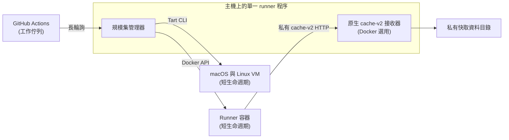

# runner

[](https://github.com/ysya/runscaler/releases)
[](https://go.dev)
[](LICENSE)
[](https://goreportcard.com/report/github.com/ysya/runscaler)

[官網](https://runscaler.ysya.dev/zh-TW.html) · [設定產生器](https://runscaler.ysya.dev/configure/zh-TW.html) | [English](README.md) | [繁體中文](README.zh-TW.md)

本文件為 [英文 README](README.md) 的繁體中文版本。更新指令、設定或操作說明時，請同步維護英文與繁體中文版本（包含 `docs/` 內的文件）；若內容有差異，以英文版為準。

以 Docker 容器或 macOS 與 Linux VM 自動擴縮 GitHub Actions 自架 runner。採用 [actions/scaleset](https://github.com/actions/scaleset)。

runner 採用**短生命週期**模式 — 每個容器／VM 只處理一個工作，完成後便會移除。不需要 Kubernetes。

**1.0 前的相容性：** Runscaler 仍在持續開發。次版本可能變更或移除指令、設定選項、
runner 映像檔與快取格式；修訂版本則以維持相容性為目標。升級前請閱讀
[發版說明](https://github.com/ysya/runscaler/releases)與[升級前準備](#upgrade-requirements)，
並備份需要保留的設定與資料。

<a id="table-of-contents"></a>

## 目錄

- [運作方式](#how-it-works)
- [功能](#features)
- [快速開始](#quick-start)
  - [Linux 系統服務](#linux-system-service)
  - [macOS 使用者服務](#macos-user-service)
- [指令](#commands)
- [文件](#documentation)
- [升級前準備](#upgrade-requirements)
- [授權條款](#license)

<a id="how-it-works"></a>

## 運作方式



1. 向 GitHub 註冊 [runner 規模集](https://docs.github.com/en/actions/hosting-your-own-runners/managing-self-hosted-runners-with-actions-runner-controller/about-actions-runner-controller)
2. 透過 scaleset API 以長輪詢接收工作指派
3. 使用 JIT（just-in-time，即時產生）runner 設定啟動 Docker 容器或 macOS 與 Linux VM
4. 工作完成後自動移除容器／VM
5. 正常停止時排空執行中的工作；若異常停止，則於下次啟動時清理遺留的資源

選用原生快取的 Docker 規模集，會由同一個 `runner` 程序在另一個私有 HTTP 位址啟動
Go cache-v2 接收器。具備快取能力的 runner 與 BuildKit 容器透過
`[actions-cache].advertise-url` 連線；已完成的項目與 payload 保存在
`[actions-cache].data-dir`。原生模式不需要另一個快取服務程序或容器。
接收器會把 artifact 等非快取 Results 請求轉送至 GitHub；獨立管理的外部接收器
仍可透過 `docker.actions-cache-url` 使用。兩種模式詳見
[主機本機 Actions 快取](docs/local-actions-cache.zh-TW.md)。

<a id="features"></a>

## 功能

- **不需 Kubernetes** — 可直接在任何 Docker 主機或 Apple Silicon Mac 上執行
- **短生命週期 runner** — 每個工作都使用全新的容器／VM，不會殘留前一個工作的狀態
- **自動擴縮** — 透過長輪詢依工作需求在 0 到 N 個 runner 之間擴縮（不需 cron，也沒有定期輪詢的延遲）
- **Docker-in-Docker** — 可選用 DinD，支援需要建置容器的工作流程
- **透過 Tart 執行 macOS 與 Linux VM** — 使用原生 Apple Virtualization.framework，搭配 APFS 寫入時複製（Copy-on-Write）複製機制
- **Tart 網路** — 預設使用共用 NAT，也可選擇橋接至主機網路介面
- **VM 預熱集區** — 預先啟動 Tart VM，即時接手工作（約 2 秒，冷啟動則約需 30 秒）
- **原生 Actions 快取（Docker 選用）** — 內建 cache-v2 接收器，提供主機本機保留設定與狀態資訊
- **共用工作磁碟區** — 可選用具名 Docker 磁碟區，讓工作明確交接檔案；舊快取磁碟區掛載目前仍在 sunset 期間
- **支援多個組織** — 單一程序即可管理多個 runner 規模集，並混用 Docker 與 Tart 供應器
- **容量自我修復** — 若容器／VM 在 GitHub 回報工作完成前退出，會自動補上
- **安全重新啟動** — SIGTERM／SIGQUIT 會停止接收新工作並等待執行中的工作完成；啟動時會回收強制終止後遺留的容器／VM
- **維運安全性** — 每台主機僅允許一個程序、健康檢查僅限 localhost 存取，並內建輪替日誌
- **單一執行檔** — 除 Docker（或 macOS 上的 Tart）外，沒有其他執行階段相依項目
- **設定檔或旗標** — 支援 TOML 設定，並可透過 CLI 旗標覆寫

<a id="quick-start"></a>

## 快速開始

先用[設定產生器](https://runscaler.ysya.dev/configure/zh-TW.html)選擇主機並複製 TOML。
將設定存到下方路徑，在主機上填入 GitHub [App 或 PAT](docs/configuration.zh-TW.md#github-credentials-and-pat-permissions)；
網頁不會要求輸入憑證內容。Linux 系統服務安裝前會檢查設定、Docker 存取權與 GitHub 憑證。

<a id="linux-system-service"></a>

### Linux 系統服務

Docker scale set 需要 Docker API 1.49 以上版本（Docker Engine 28.1+）。

先在主機上啟動 Docker，再執行：

```bash
curl -fsSL https://raw.githubusercontent.com/ysya/runscaler/main/install.sh | sudo sh
sudo install -d -m 0700 /etc/runner
sudoedit /etc/runner/config.toml  # 貼上 TOML 並在主機填入憑證
sudo chmod 0600 /etc/runner/config.toml
sudo /usr/local/bin/runner service install --config-path /etc/runner/config.toml
sudo /usr/local/bin/runner status
```

服務使用專用的非 root 帳號。在設定產生器中選擇 Docker，並輸入要用在
`runs-on` 的規模集名稱。使用者服務、憑證環境檔及其他安裝方式請見
[部署](docs/deployment.zh-TW.md#service-layout)。
安裝成功後，runner 會為每個已設定的規模集印出可複製的 `runs-on` 行。

<a id="macos-user-service"></a>

### macOS 使用者服務

先安裝 [Tart](https://tart.run/) 並拉取與主機相容的 macOS 或 Linux 映像檔；
[安裝與映像檔選擇](docs/deployment.zh-TW.md#tart-prerequisites-macos)列有指令。
然後從本機 GUI 登入階段執行：

```bash
curl -fsSL https://raw.githubusercontent.com/ysya/runscaler/main/install.sh | sh -s -- --user
mkdir -p ~/.config/runner
chmod 0700 ~/.config/runner
nano ~/.config/runner/config.toml  # 貼上 TOML 並在主機填入憑證
chmod 0600 ~/.config/runner/config.toml
~/.local/bin/runner validate
~/.local/bin/runner service install --scope user
~/.local/bin/runner status
```

在設定產生器中選擇 Tart，輸入剛拉取的映像檔，以及要用在 `runs-on`
的規模集名稱。LaunchAgent 會在登入時啟動。Linux 使用者安裝也可使用
相同的 runner 指令；詳見[部署](docs/deployment.zh-TW.md#service-layout)。

在工作流程中使用設定產生器輸入的名稱（安裝服務後也會列出）：

```yaml
jobs:
  build:
    runs-on: my-runners
    steps:
      - uses: actions/checkout@v4
      - run: echo "Running on auto-scaled runner!"
```

以前景方式執行或使用 CLI 旗標時，請見[指令](docs/commands.zh-TW.md)與
[設定](docs/configuration.zh-TW.md)。

<a id="commands"></a>

## 指令

| 指令 | 說明 |
| ------------------------ | ------------------------------------------------------ |
| `runner run` | 啟動 runner 管理程序 |
| `runner validate` | 驗證設定與連線 |
| `runner status` | 顯示容量、工作、原生快取與磁碟剩餘空間 |
| `runner doctor` | 診斷 GitHub 連線與孤立的容器／VM |
| `runner cache` | 顯示各快取儲存區的磁碟用量與保留原則 |
| `runner logs` | 顯示／持續追蹤 runner 的輪替日誌檔 |
| `runner service` | 安裝、重新產生（`--force`）、啟動、停止與檢查服務 |
| `runner version` | 顯示版本、提交、建置日期與執行階段資訊 |
| `runner update` | 將 runner 更新至最新發行版本 |
| `runner update --check` | 檢查更新但不安裝 |
| `runner update --restart` | 更新、驗證設定並重啟服務 |
| `runner scaleset delete` | 從 GitHub 移除已停用的 runner 規模集 |

各指令的詳細說明請見 [docs/commands.zh-TW.md](docs/commands.zh-TW.md)。

<a id="documentation"></a>

## 文件

| 文件 | 內容 |
| --- | --- |
| [指令](docs/commands.zh-TW.md) | 狀態儀表板、更新、使用 `doctor` 疑難排解、日誌、Runner 啟動與失敗復原 |
| [設定](docs/configuration.zh-TW.md) | 設定檔（TOML）、GitHub App 驗證、權杖安全性、CLI 旗標 |
| [主機本機 Actions 快取](docs/local-actions-cache.zh-TW.md) | 內建接收器架構、外部接收器、部署與回復 |
| [快取](docs/caching.zh-TW.md) | 哪些資料可以回收、磁碟防護機制、儲存區保留設定、檢視空間使用情況 |
| [安全性與隔離](docs/security.zh-TW.md) | 共用 Docker socket 的風險、各 runner 規模集的隔離設定、Tart VM 隔離 |
| [部署](docs/deployment.zh-TW.md) | 正常關閉、服務配置、Systemd |
| [開發](docs/development.zh-TW.md) | 建置、架構 |

<a id="upgrade-requirements"></a>

## 升級前準備

已移除 `runner init`。既有設定檔與已安裝服務可繼續使用；建立新設定檔請用
[設定產生器](https://runscaler.ysya.dev/configure/zh-TW.html)，並在主機上填入憑證。

**Actions 快取設定 sunset（本版尚未移除）：** 使用內建 Go 接收器的 Docker scale set
應設定 `native-actions-cache = true`，並在 `actions-cache-url` 與
`[actions-cache].advertise-url` 相同時移除前者。管理程序會自動帶入該 URL。
舊的原生 URL 設定目前仍可運作，但 `runner validate`、啟動日誌與
`runner update --check` 會提醒在未來的破壞相容版本前完成遷移。外部接收器仍支援
明確 URL。全域 `advertise-url` 仍須保留，並確保 runner 與 BuildKit 容器可連線。
請在工作排空後修改、驗證設定，再重啟選定服務；這項設定變更不搬移或刪除快取資料。
舊版 binary 無法偵測其發布後才新增的 sunset 警告，因此更新前仍須閱讀目標版本的
release notes。
舊的 `docker.cache-volumes` 與 `[[docker.cache]]` 掛載也在 sunset 期間，
仍依原有容量設定運作。先把 workflow 遷移至 Actions cache 並驗證熱快取命中，
再移除掛載或處理舊資料。
最早移除檢討版與驗收條件記在 [issue #41](https://github.com/ysya/runscaler/issues/41)：
原生 URL 舊用法為 v0.22.0、舊快取 volumes 為 v0.24.0。到版號不會自動移除；
若遷移條件未達成，就延後破壞相容變更。

歷史更名相容期已結束。後續 release 僅產出 `runner-*` 壓縮檔，不再支援 `migrate` 指令、根指令 `runner --config` 直接啟動、`--backend`、自動搜尋 `runscaler` 設定目錄、舊服務名稱與 `RUNSCALER_TOKEN` 備援。啟動 manager 請使用 `runner run --config /absolute/path/config.toml`。

升級前請改用目前的設定名稱：

| 已移除設定 | 目前設定 |
| --- | --- |
| `backend` | `provider` |
| `docker.shared-volume-ttl` | `docker.shared-volume-max-age` |
| `tart.cache-space-budget` | `tart.cache-budget` |
| `RUNSCALER_TOKEN` 備援 | `RUNNER_TOKEN` |

已移除的 TOML 設定鍵會明確報錯，不會自動翻譯或忽略。仍使用更名過渡期格式的安裝，須先手動準備目前的 binary、config 與服務定義，再升級至此版本。既有資料與舊備份檔案保持原樣。已使用目前 `runner` 格式的 Linux root 系統服務仍受支援，更新與 `--force` 都保留原身分。

獨立執行時，設定搜尋順序為目前目錄、目前使用者的 runner 設定目錄、`/etc/runner`；明確指定 `--config` 時使用該路徑。絕對路徑的 `XDG_CONFIG_HOME` 與 `XDG_STATE_HOME` 可自訂 user 設定／state 位置，相對值會被忽略。user 服務安裝會記錄這些變數與設定檔的絕對路徑，管理指令則使用已安裝服務的設定。設定產生器會說明標準設定路徑；服務安裝時 `--config-path` 優先於 `--config`。

<a id="license"></a>

## 授權條款

MIT
